# Mapa

**Descubra onde vale a pena automatizar, na primeira conversa com o cliente.**

| Ranking de oportunidades | Matriz esforço × retorno | Relatório (também em PDF) |
|---|---|---|
| [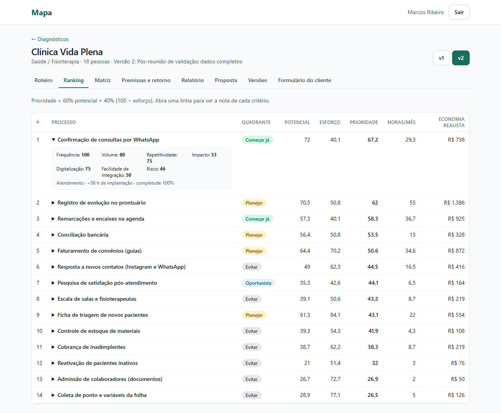](docs/screenshots/04-ranking.png) | [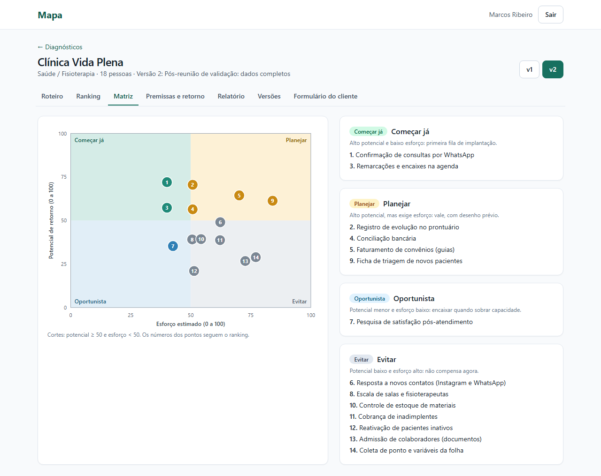](docs/screenshots/05-matriz-esforco-retorno.png) | [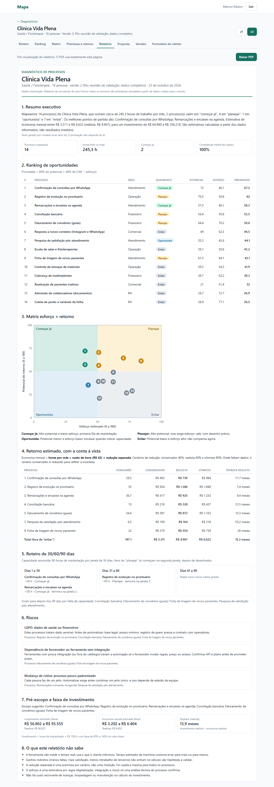](docs/exemplo-de-relatorio/diagnostico-clinica-vida-plena-v2.pdf) |

> **Leia antes:** este é um **estudo de caso**. A consultoria (Atalho Automação) e o cliente (Clínica Vida Plena) são **fictícios**, as reuniões foram **simuladas** (com o Claude no papel das pessoas) e os números são **estimativas calculadas** a partir de dados criados para o estudo, nunca resultados medidos. Não há cliente real, operação real, produção nem hospedagem: tudo roda localmente. O que é real: o código, os testes e as falhas registradas.

## Resumo

1. O **Mapa** é uma ferramenta que o consultor usa na primeira reunião: conduz um roteiro de perguntas por área e registra cada processo do cliente.
2. Um **motor de pontuação determinístico** (sem IA) dá a cada processo um potencial e um esforço, com critérios, pesos e contas documentados.
3. Ele gera **ranking**, **matriz esforço × retorno**, **roteiro de 30/60/90 dias**, retorno em **três cenários** (faixa, não número exato) e riscos de LGPD.
4. O **relatório** sai em web e em **PDF**, com versões comparáveis e, na v1.1, um **modelo de proposta**.
5. O diferencial é o raciocínio de consultor: **critérios claros, contas à vista e honestidade sobre a incerteza**.

Construído por [João Gabriel Maia da Costa](#o-que-este-projeto-demonstra-sobre-mim). Versões: `v1.0.0` (MVP) e `v1.1.0` (proposta). Veja o [CHANGELOG](CHANGELOG.md).

## Como o discovery foi feito

Eu não tinha um cliente real, então **simulei**: o Claude interpretou o sócio-consultor, a analista de projetos e o dono da clínica em reuniões que registrei em [`docs/01-discovery`](docs/01-discovery/). Todo registro simulado começa com a linha *"Simulação: o Claude interpretou o cliente nesta conversa."* Nelas apareceram contradições que mudaram o produto (o sócio queria rapidez, a analista profundidade), pedidos vagos que refinei e uma restrição que mudou o escopo (dado de paciente não pode sair da máquina). Se eu tiver anotações de uma conversa real e autorizada, elas substituem a simulação. A seção "Minha experiência real" deste README é um texto de exemplo a ser substituído.

## Mapa do repositório

| Pasta | O que tem |
|---|---|
| [`docs/`](docs/INDEX.md) | Toda a documentação. Comece pelo [INDEX](docs/INDEX.md) |
| [`docs/00-sobre-este-caso`](docs/00-sobre-este-caso/README.md) | Quem sou, personagens, o que é simulado e o que é real |
| [`docs/01-discovery`](docs/01-discovery/01-brainstorm-e-decisao.md) | Brainstorm, negócio, 3 reuniões simuladas, AS-IS, perguntas-chave |
| [`docs/02-definicao`](docs/02-definicao/requisitos.md) | Requisitos, regras de negócio, histórias, backlog, riscos, rastreabilidade |
| [`docs/03-metodologia`](docs/03-metodologia/README.md) | **Documento central:** critérios, pesos, fórmulas, exemplos, sensibilidade, limitações |
| [`docs/04-arquitetura`](docs/04-arquitetura/modelo-er.md) | 5 ADRs, modelo ER, sequência, modos de falha, wireframes, validação |
| [`docs/05-qualidade`](docs/05-qualidade/relatorio-de-testes.md) | Relatório de testes real, aceitação, reviews das 3 sprints |
| [`docs/06-pos-lancamento`](docs/06-pos-lancamento/roadmap.md) | Retrospectiva, PR da v1.1, roadmap |
| [`docs/screenshots`](docs/screenshots/) | 14 prints gerados pelo próprio app |
| [`docs/exemplo-de-relatorio`](docs/exemplo-de-relatorio/diagnostico-clinica-vida-plena-v2.pdf) | PDF de exemplo gerado de verdade |
| [`docs/entrevista`](docs/entrevista/README.md) · [`docs/vitrine`](docs/vitrine/README.md) | Perguntas de entrevista; currículo, post e respostas |
| [`src/lib/scoring`](src/lib/scoring) | Motor de pontuação (funções puras, sem I/O) |
| [`src/app`](src/app) · [`src/components`](src/components) | Telas Next.js e componentes |
| [`prisma/`](prisma) | Schema e seed da Clínica Vida Plena |
| [`tests/`](tests) | Unitários, integração e E2E (inclui o gerador de prints) |
| [`scripts/`](scripts) | Sensibilidade, PDF de exemplo, limpeza da demo |

## Roteiro de leitura em 7 passos

1. **Discovery:** [por que este projeto](docs/01-discovery/01-brainstorm-e-decisao.md) e as [três reuniões](docs/01-discovery/03-reuniao-socio.md) ([2](docs/01-discovery/04-reuniao-analista.md), [3](docs/01-discovery/05-reuniao-dono-clinica.md)).
2. **Requisitos:** [requisitos](docs/02-definicao/requisitos.md), [regras de negócio](docs/02-definicao/regras-de-negocio.md) e [rastreabilidade](docs/02-definicao/rastreabilidade.md).
3. **Metodologia:** [critérios e pesos](docs/03-metodologia/README.md), [exemplos de cálculo](docs/03-metodologia/exemplos-de-calculo.md), [sensibilidade](docs/03-metodologia/sensibilidade.md) e [limitações](docs/03-metodologia/limitacoes.md).
4. **Decisões:** [ADR-001](docs/04-arquitetura/adr-001-pontuacao-deterministica.md) a [ADR-005](docs/04-arquitetura/adr-005-link-do-cliente.md) e a [validação com recusa justificada](docs/04-arquitetura/reuniao-validacao.md).
5. **Modelo:** [ER, camadas](docs/04-arquitetura/modelo-er.md), [sequência](docs/04-arquitetura/sequencia-relatorio.md) e [modos de falha](docs/04-arquitetura/modos-de-falha.md).
6. **Relatório de exemplo:** abra o [PDF da v2](docs/exemplo-de-relatorio/diagnostico-clinica-vida-plena-v2.pdf).
7. **Qualidade e evolução:** [relatório de testes](docs/05-qualidade/relatorio-de-testes.md), [reviews](docs/05-qualidade/sprint-1-review.md), [PR da v1.1](docs/06-pos-lancamento/pr-v1.1-proposta.md) e [minha retrospectiva](docs/06-pos-lancamento/retrospectiva-final.md).

## A metodologia em uma página

Versão completa em [`docs/03-metodologia`](docs/03-metodologia/README.md).

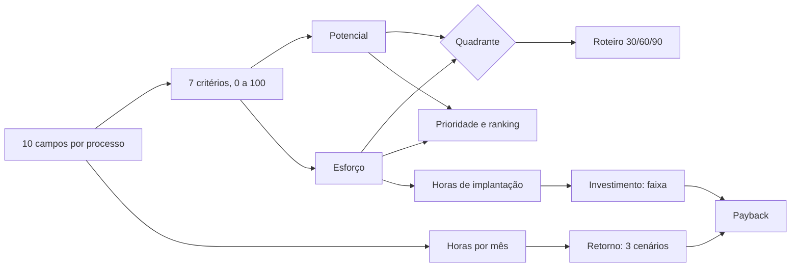

- **Horas/mês** = execuções por mês × minutos × pessoas ÷ 60.
- **Potencial** = 20% frequência + 15% volume + 25% repetitividade + 40% impacto (tempo e erro).
- **Esforço** = 35% (100 − digitalização) + 35% (100 − integração) + 30% risco (dado sensível e dependências).
- **Quadrantes:** potencial ≥ 50 e esforço < 50 → *Começar já*; potencial ≥ 50 e esforço ≥ 50 → *Planejar*; abaixo, *Oportunista* ou *Evitar*.
- **Economia mensal** = horas/mês × custo da hora × redução (40% / 60% / 80%: conservador, realista, otimista). **Dado faltante nunca vira zero:** entra valor cauteloso e a faixa se alarga.
- **Investimento** = horas de implantação (16 a 120, conforme o esforço) × hora do consultor, em faixa de 85% a 140%. **Payback** = investimento ÷ economia.

> Pesos e cortes são **julgamento meu, não calibrados com dados reais**. Por isso são configuráveis, há [análise de sensibilidade](docs/03-metodologia/sensibilidade.md) e o relatório declara o que não sabe.

## Tour pelo sistema

Cada tela abaixo é um print real do app, com o seed da Clínica Vida Plena.

### Roteiro por área
[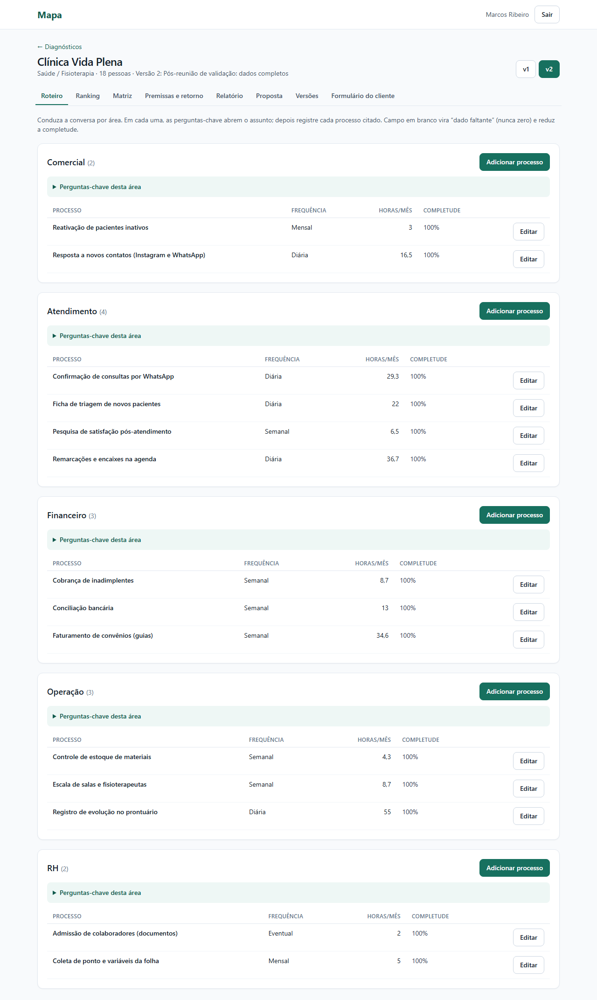](docs/screenshots/02-roteiro-por-area.png)

Conduz a conversa por área, com três perguntas-chave e o porquê de cada uma. **Decisão:** todo campo é opcional, exceto a frequência. Resolve o conflito entre a pressa do sócio e a profundidade da analista; campo em branco vira *dado faltante*, com a lacuna sinalizada.

### Cadastro de processo
[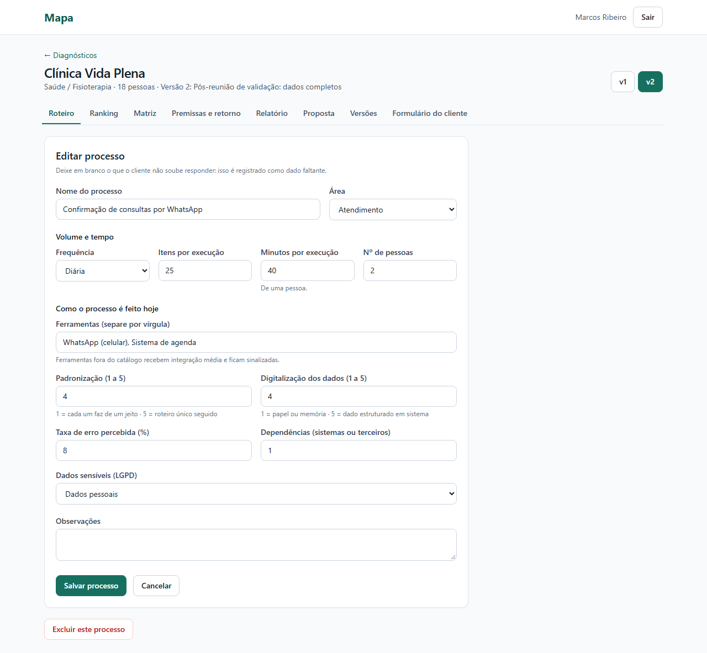](docs/screenshots/03-cadastro-de-processo.png)

Dez campos de levantamento (a frequência e nove opcionais), com a escala explicada em cada um. **Decisão:** a validação roda no servidor (o limite do navegador não é a defesa) e vazio vira `null`, nunca zero.

### Ranking
[](docs/screenshots/04-ranking.png)

Prioridade ordenada, com a nota de cada critério ao abrir a linha. **Decisão:** a explicação vem da conta, não da opinião, para responder "por que esse primeiro?".

### Matriz esforço × retorno
[](docs/screenshots/05-matriz-esforco-retorno.png)

Quatro quadrantes com nomes em português. **Decisão:** pontos numerados mais lista ao lado, porque nomes longos se sobrepõem em 14 pontos.

### Premissas e faixa de retorno
[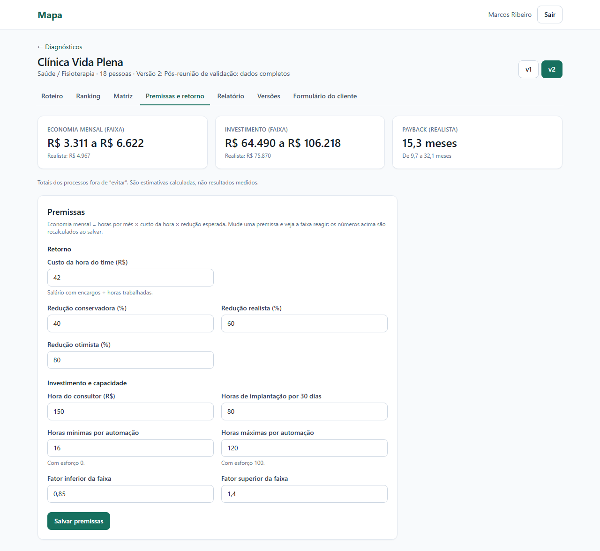](docs/screenshots/06-premissas-e-faixa-de-retorno.png)

Custo da hora, reduções, hora do consultor e capacidade, com recálculo ao salvar. **Decisão:** a faixa aparece sempre; o valor "realista" vem ao lado, nunca sozinho.

### Relatório web e PDF
[](docs/screenshots/07-relatorio-web.png)

Resumo executivo, ranking, matriz, retorno com a conta à vista, 30/60/90, riscos, pré-escopo e "o que este relatório não sabe". **Decisão:** o PDF é a própria página de impressão renderizada pelo Chromium, para web e PDF nunca divergirem ([ADR-003](docs/04-arquitetura/adr-003-geracao-de-pdf.md)). [PDF de exemplo](docs/exemplo-de-relatorio/diagnostico-clinica-vida-plena-v2.pdf).

### Formulário do cliente
[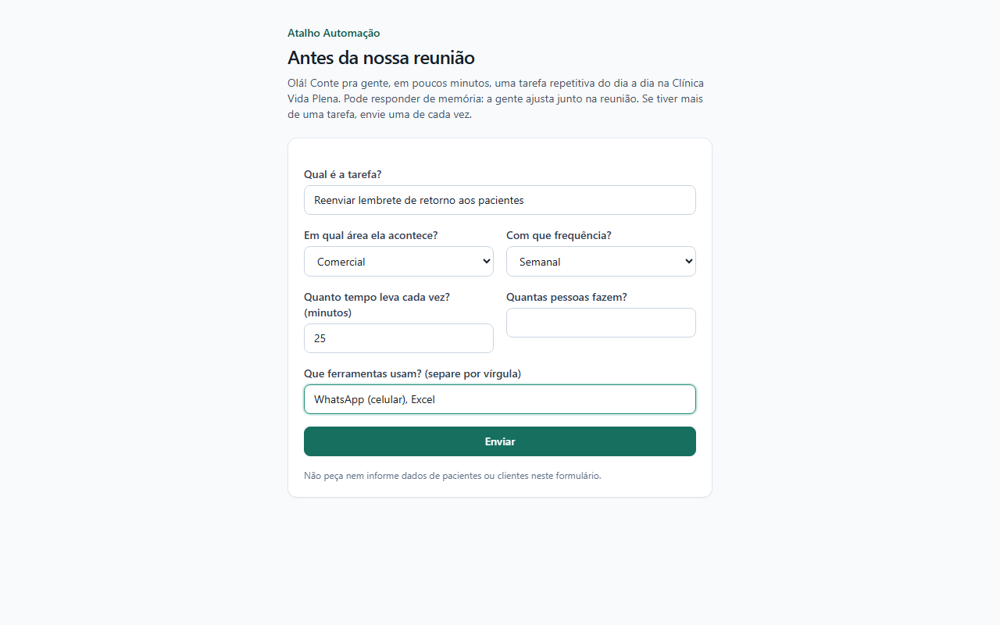](docs/screenshots/08-formulario-do-cliente.png)

Seis campos, por link com validade de 14 dias. **Decisão:** o link só escreve (acrescenta processos "para revisar") e nunca lê nada ([ADR-005](docs/04-arquitetura/adr-005-link-do-cliente.md)).

### Comparação de versões
[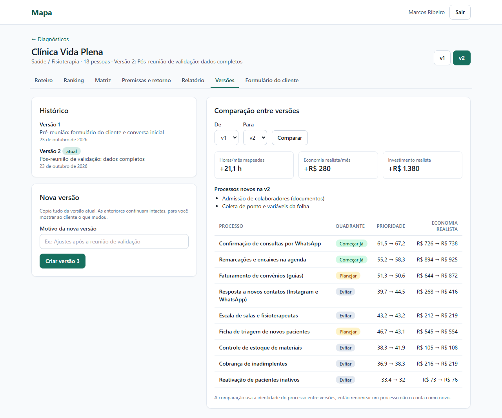](docs/screenshots/09-comparacao-de-versoes.png)

Mostra o que mudou entre a v1 (com dados faltando) e a v2 (completa). **Decisão:** cada versão é um retrato completo e imutável ([ADR-004](docs/04-arquitetura/adr-004-versoes.md)).

### Versão mobile
[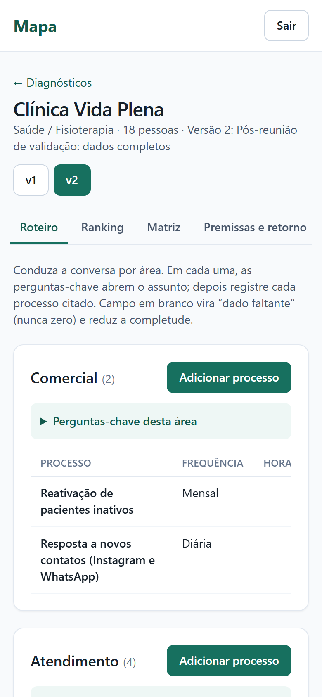](docs/screenshots/10-versao-mobile-roteiro.png) [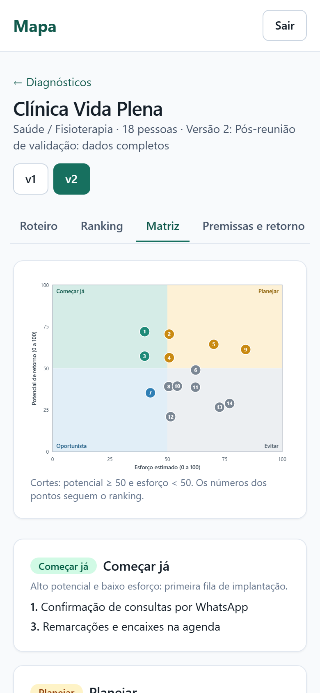](docs/screenshots/10-versao-mobile-matriz.png)

A página não tem rolagem horizontal em 390 px (testado). **Limitação:** as tabelas rolam dentro do cartão e a coluna de horas pode ficar fora da tela; está no roadmap.

### Proposta (v1.1)
[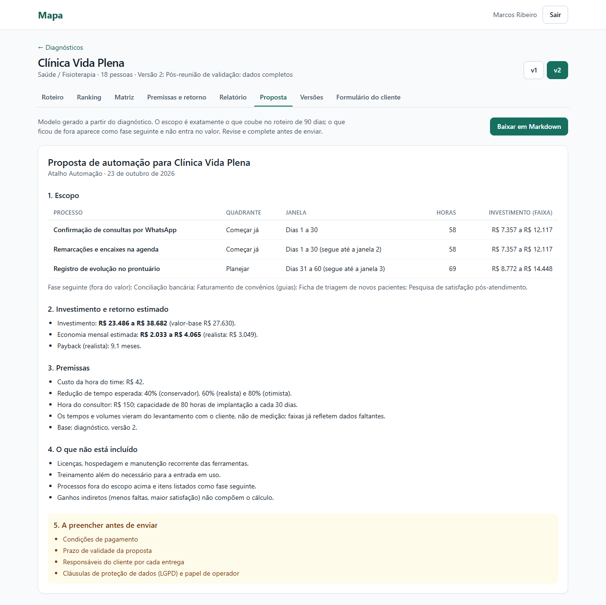](docs/screenshots/12-proposta-v1-1.png)

Modelo de proposta gerado do diagnóstico, com escopo igual ao que coube nos 90 dias e lista do que o consultor deve preencher. **Decisão:** não invento condições de pagamento nem cláusulas; ficam como campos "a preencher".

## As 5 decisões mais importantes e seus trade-offs

| # | Decisão | Ganho | Trade-off | Eu mudaria se... |
|---|---|---|---|---|
| 1 | **Pontuação determinística, não IA** ([ADR-001](docs/04-arquitetura/adr-001-pontuacao-deterministica.md)) | Explicável, reprodutível, privada, testável | Menos flexível com texto livre | Eu tivesse dados reais para calibrar sugestões de peso |
| 2 | **Faixas e dado faltante cauteloso** ([metodologia](docs/03-metodologia/README.md)) | Mostra a incerteza; o dado faltante trocou o 1º colocado no exemplo | O consultor não recebe "um número só" | O cliente exigisse um número único (eu manteria a faixa e destacaria o realista) |
| 3 | **PDF pelo Chromium** ([ADR-003](docs/04-arquitetura/adr-003-geracao-de-pdf.md)) | Web e PDF idênticos | Depende de navegador; lento | O uso fosse em escala hospedada |
| 4 | **Versões como retratos** ([ADR-004](docs/04-arquitetura/adr-004-versoes.md)) | Reprodução fiel e comparação simples | Duplica dados; sem auditoria por campo | Houvesse vários editores no mesmo diagnóstico |
| 5 | **Link do cliente só de escrita** ([ADR-005](docs/04-arquitetura/adr-005-link-do-cliente.md)) | Zero exposição de dados; zero atrito | Link vazado permite lixo por até 14 dias | O link passasse a mostrar qualquer dado |

## Arquitetura e modelo de dados

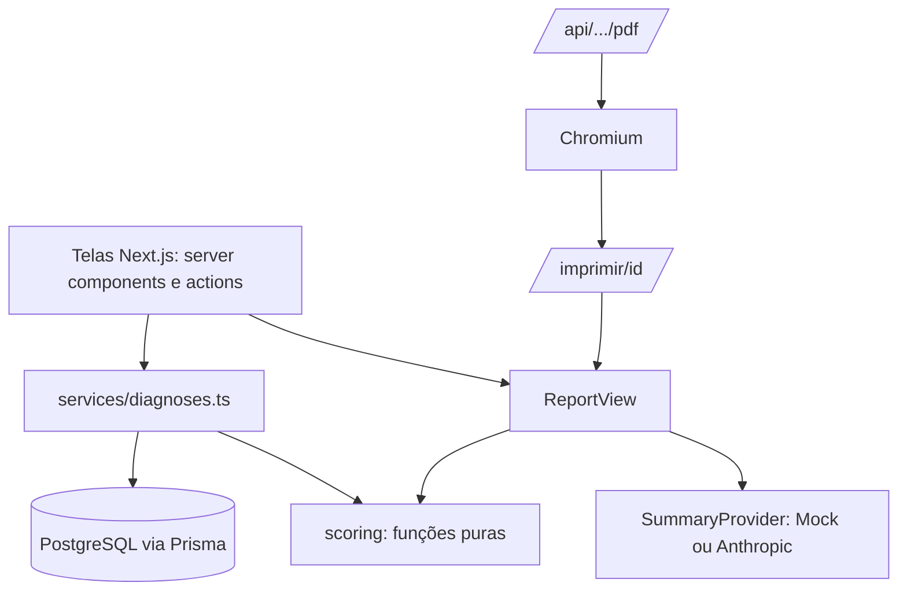

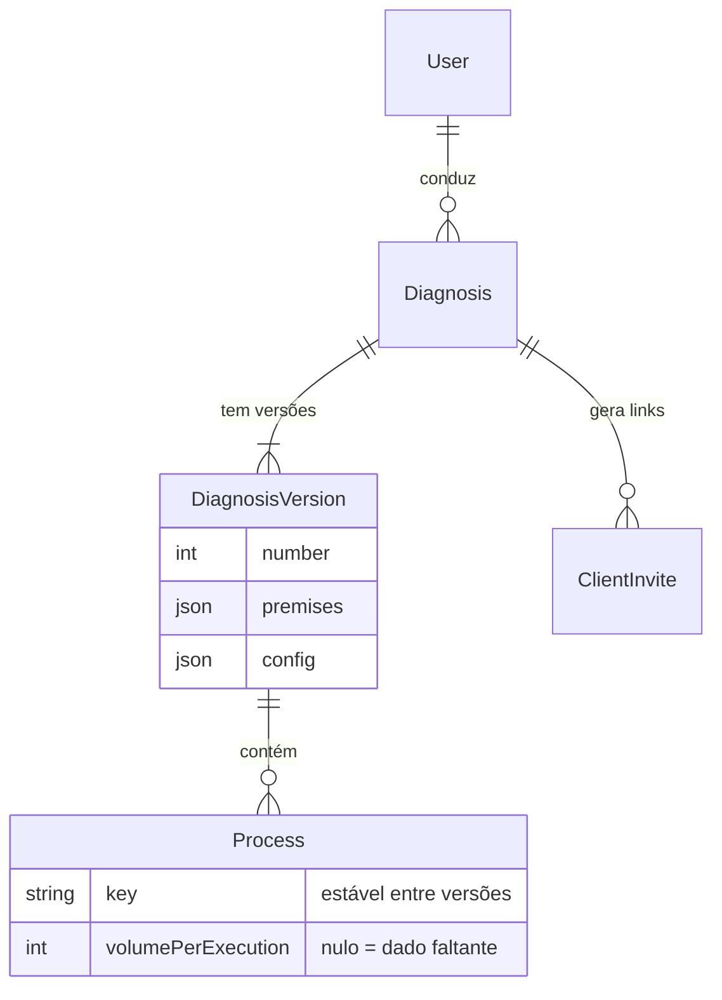

Resultados (potencial, ranking, retorno) **não são gravados**: são calculados a cada leitura, para não haver duas fontes da verdade. Detalhes em [modelo-er](docs/04-arquitetura/modelo-er.md).

## Qualidade (execução real)

Na v1.1.0, no meu computador: **96 testes no Vitest** (85 unitários e 11 de integração, contra um Postgres de teste separado), **12 testes E2E** com Playwright, tipos e lint sem erros. Cobertura medida do módulo de pontuação: **100%** (o restante não teve cobertura medida). No caminho tive falhas reais, registradas no [relatório de testes](docs/05-qualidade/relatorio-de-testes.md): o Prisma recusou um comando destrutivo disparado por agente (redesenhei o teste, sem contornar), três testes E2E falharam por erro de seletor e dois prints saíram com a tela errada com os testes passando.

**Não foi testado:** a chamada real à API da Anthropic (só o `MockProvider` e o fallback), a falha do Chromium, a queda do banco, carga e acessibilidade automatizada.

## Como rodar localmente

Requisitos: Node 20+, Docker e Git. A aplicação não está hospedada; o código e a documentação estão neste repositório. Tudo roda na sua máquina.

```bash
git clone https://github.com/Joaogabrielmaia/Process-diagnostic-tool.git
cd Process-diagnostic-tool
npm install
npx playwright install chromium     # usado pelo PDF e pelos testes E2E
cp .env.example .env                # valores de desenvolvimento local; sem segredos reais
npm run db:up                       # PostgreSQL em Docker (porta 5433)
npm run db:push                     # cria as tabelas
npm run db:seed                     # cria a Clínica Vida Plena (2 versões, 14 processos)
npm run dev                         # http://localhost:3000
```

Entre com `marcos@atalho.example` e a senha definida em `SEED_CONSULTANT_PASSWORD` no `.env` (padrão do `.env.example`: `mapa-demo-local`, **só para demonstração local**).

```bash
npm run typecheck && npm run lint
npm test                    # unitários
npm run test:integration    # usa o banco mapa_test
npm run test:e2e            # com o app rodando
npm run screenshots         # regenera os prints (rode antes: npm run demo:clean)
npm run report:pdf          # regenera o PDF de exemplo
npm run sensitivity         # tabelas de sensibilidade
```

> `npm run db:reset` usa `--force-reset` e **apaga o banco**: é para uso manual seu, em banco de desenvolvimento.

O resumo por IA é opcional: sem chave, o `MockProvider` é usado. Para ligar, defina `SUMMARY_PROVIDER=anthropic` e `ANTHROPIC_API_KEY` no `.env`. Essa integração não foi testada contra a API real.

## Limitações honestas e roadmap

- Pesos e cortes **não foram calibrados** com dados reais; a redução esperada é a mesma para todos os processos; horas liberadas não viram dinheiro automaticamente. Lista completa em [limitações](docs/03-metodologia/limitacoes.md).
- Tudo é fictício e simulado; os resultados mostram que a ferramenta é coerente, não que prevê o mundo real.
- Tabelas pouco legíveis no celular; sem limite de tentativas de login; sem auditoria de acessibilidade automatizada.
- **Roadmap:** editar pesos pela tela, sensibilidade de pesos, aviso de cenários que colapsam, testes dos caminhos de erro e, com projetos reais, um ciclo de calibração. Veja o [roadmap](docs/06-pos-lancamento/roadmap.md).

## O que este projeto demonstra sobre mim

- **Discovery estruturado:** transformei reuniões (simuladas) com pedidos vagos e contradições em requisitos rastreáveis, sem esconder o conflito entre rapidez e profundidade.
- **Raciocínio de consultor, não só de código:** critérios explícitos, contas à vista, faixas em vez de números exatos e a escolha deliberada de não usar IA onde ela tiraria a explicabilidade.
- **Honestidade técnica:** registrei o que não foi testado, o viés em que incorri (ajustei premissas olhando o resultado) e as falhas do caminho.
- **Engenharia de ponta a ponta:** full stack tipado (Next.js, Prisma, PostgreSQL, Zod), 96 testes no Vitest e 12 E2E, PDF por Chromium, versões e evolução com branch, changelog e tag.
- **Comunicação:** decisões com contexto, alternativas, escolha, motivo, trade-off e "quando eu mudaria de ideia", em português claro.

### Minha experiência real

> **Texto de exemplo, escrito como modelo.** Substitua pelos fatos da sua trajetória antes de usar como apresentação pessoal.

No atendimento direto a clientes, aprendi que o cliente raramente sabe descrever o problema em termos técnicos: ele descreve o incômodo ("a recepção passa a manhã no WhatsApp"). Meu trabalho no discovery é transformar esse incômodo em perguntas objetivas (quantas vezes, quanto tempo, quem faz, onde ficam os dados) e devolver uma resposta que ele entenda e possa questionar. Foi dessa prática que veio a decisão central do Mapa: mostrar a conta e a incerteza em vez de um número pronto, porque a confiança do cliente se constrói quando ele consegue acompanhar o raciocínio.

## Licença

[MIT](LICENSE) © João Gabriel Maia da Costa.
