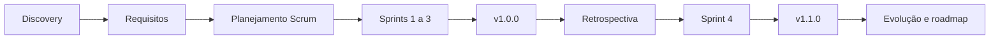
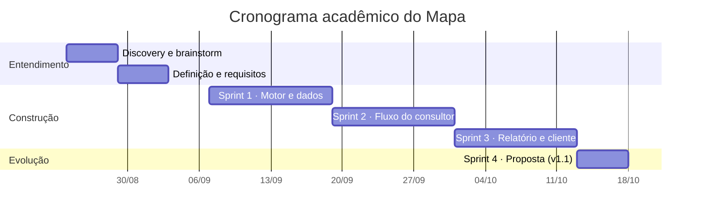
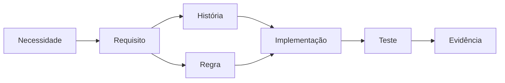
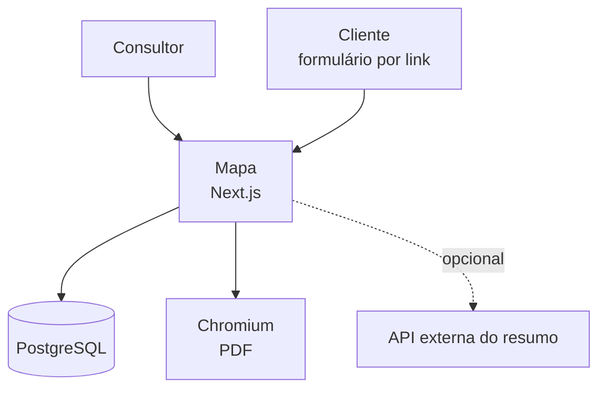
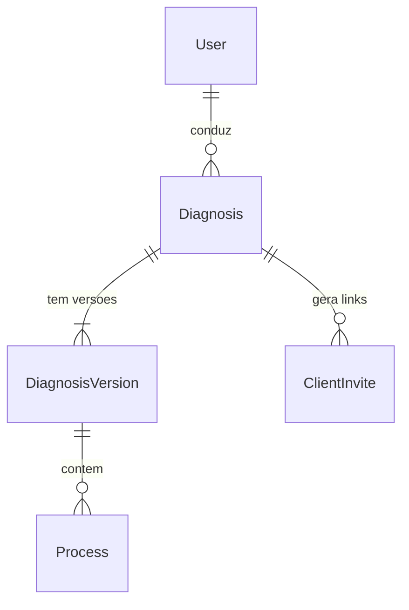
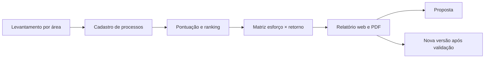

# Mapa

**Diagnóstico de processos para consultorias de automação: pontuação determinística e explicável, faixa de retorno em vez de número único, roteiro 30/60/90 e relatório em PDF.**

Documentação em série: [guia e trilhas de leitura](docs/INDEX.md) · [relatório do ciclo de vida](docs/ciclo-de-vida/README.md) · [glossário](docs/GLOSSARIO.md) · [galeria de prints](docs/screenshots/README.md)

## O problema e a solução

Cenário: a Atalho Automação, consultoria fictícia de quatro pessoas, faz o diagnóstico numa conversa solta, com anotações em caderno e prioridade pela experiência do consultor ([AS-IS](docs/01-discovery/06-processo-as-is.md)).
O cliente, a Clínica Vida Plena, descreve incômodos, não processos. Sem critério escrito, a ordem de prioridade e a estimativa de retorno viram opinião.

Solução: o Mapa conduz o levantamento por área, pontua cada processo com critérios e pesos escritos e entrega ranking, matriz esforço × retorno, roteiro de 30/60/90 dias, relatório em PDF e modelo de proposta.

## Demonstração visual

| Matriz esforço × retorno | Relatório web |
|---|---|
|  |  |
| **Premissas e faixa de retorno** | **Proposta (v1.1)** |
|  |  |

*Sequência de capturas do app rodando, não gravação contínua.* Relatório de exemplo em PDF: [versão 2](docs/exemplo-de-relatorio/diagnostico-clinica-vida-plena-v2.pdf) (primeira página em [prévia](docs/exemplo-de-relatorio/v2-pagina-1.png)) · [versão 1](docs/exemplo-de-relatorio/diagnostico-clinica-vida-plena-v1.pdf).

## Ficha técnica

| Campo | Valor |
|---|---|
| Natureza | Estudo de caso fictício |
| Stack | Next.js, TypeScript, Prisma, PostgreSQL, Zod, Vitest, Playwright |
| Testes | 89 unitários (`1f4473f`), 11 de integração e 15 E2E (`bd3169b`), todos em 2026-10-24 ([logs](docs/05-qualidade/README.md)) |
| Versões | `v1.0.0` e `v1.1.0` ([CHANGELOG](CHANGELOG.md)) |

## Principais funcionalidades

- **Pontuação determinística:** sete critérios viram potencial, esforço, quadrante e prioridade, com pesos e cortes configuráveis por versão (`src/lib/scoring`, [metodologia](docs/03-metodologia/README.md)).
- **Retorno em faixa:** economia, investimento e payback em três cenários, com dado faltante tratado com valor cauteloso, nunca zero (regra RN-08).
- **Roteiro 30/60/90:** ordem de implantação a partir dos quadrantes e da capacidade em horas.
- **Relatório web e PDF:** a mesma página nos dois formatos, gerada pelo Playwright ([ADR-003](docs/04-arquitetura/adr-003-geracao-de-pdf.md)).
- **Versões como retrato:** cada versão é uma cópia completa, com comparação entre versões ([ADR-004](docs/04-arquitetura/adr-004-versoes.md)).
- **Formulário do cliente por link:** token, só escrita, validade de 14 dias ([ADR-005](docs/04-arquitetura/adr-005-link-do-cliente.md)).
- **Modelo de proposta (v1.1):** escopo igual ao que coube nos 90 dias.

## Ciclo de vida: do discovery à evolução

O relatório completo está em [docs/ciclo-de-vida](docs/ciclo-de-vida/README.md): visão e discovery, planejamento Scrum, requisitos, arquitetura, dados, desenvolvimento, testes, implantação e evolução.

### Linha do tempo e marcos

Datas do cronograma acadêmico; commits e tags têm as datas reais registradas no [histórico](docs/ciclo-de-vida/06-desenvolvimento-e-configuracao.md).

## Scrum e planejamento de sprints

Product Goal, backlog priorizado com MoSCoW, plano de releases e Definition of Done em [planejamento e Scrum](docs/ciclo-de-vida/02-planejamento-e-scrum.md).

| Sprint | Objetivo | Entrega |
|---|---|---|
| [1 · Motor e dados](docs/ciclo-de-vida/sprints/sprint-1.md) | Pontuação testada e dados de demonstração | Motor, modelo Prisma, seed |
| [2 · Fluxo do consultor](docs/ciclo-de-vida/sprints/sprint-2.md) | Do login ao ranking e às premissas | Telas do consultor, 11 testes de integração |
| [3 · Relatório, versões e cliente](docs/ciclo-de-vida/sprints/sprint-3.md) | Relatório web e PDF, versões, formulário | Relatório, PDF, E2E, prints |
| [4 · Proposta](docs/ciclo-de-vida/sprints/sprint-4.md) | Modelo de proposta | v1.1.0 |

## Reuniões e decisões com o cliente

Seis reuniões simuladas, com participantes por papel, mais o brainstorm do produto ([registro](docs/ciclo-de-vida/reunioes/README.md)): três de discovery, uma de validação, uma de aceitação e uma de retrospectiva.

| Reunião | Decisão |
|---|---|
| [Sócio-consultor](docs/01-discovery/03-reuniao-socio.md) | Faixa com valor realista em destaque; formulário prévio |
| [Analista](docs/01-discovery/04-reuniao-analista.md) | Dez campos, todos opcionais exceto a frequência |
| [Dono da clínica](docs/01-discovery/05-reuniao-dono-clinica.md) | Tudo local; IA só com números agregados; formulário só de escrita |
| [Validação](docs/04-arquitetura/reuniao-validacao.md) | 7 pedidos tratados e 1 recusa justificada |

## Requisitos e rastreabilidade

17 requisitos funcionais, 7 não funcionais, 12 regras de negócio e 14 histórias, ligados por IDs ([requisitos](docs/02-definicao/requisitos.md), [regras](docs/02-definicao/regras-de-negocio.md), [histórias](docs/02-definicao/historias.md)). A cadeia vai da necessidade ao teste, com exemplo percorrido para a regra RN-08 em [requisitos e rastreabilidade](docs/ciclo-de-vida/03-requisitos-e-rastreabilidade.md).

## Arquitetura e decisões técnicas

[Arquitetura e ADRs](docs/ciclo-de-vida/04-arquitetura-e-adrs.md): contexto, componentes, árvore de decisão da pontuação, sequência do relatório e cinco ADRs.

### Decisão difícil

| | [ADR-001 · Pontuação determinística em vez de IA](docs/04-arquitetura/adr-001-pontuacao-deterministica.md) |
|---|---|
| Contexto | A pontuação decide o que vale automatizar, e o dono da clínica deixou claro que dado de paciente não pode sair da máquina |
| Alternativas | IA avalia e pontua; híbrido (regras calculam, IA ajusta); regras determinísticas, com IA só redigindo texto opcional |
| Escolha | Regras determinísticas; a IA, se ligada, só redige o resumo a partir de números já calculados |
| Custo aceito | Menos flexibilidade: uma IA captaria nuances de descrição livre que a regra não vê |
| Quando mudaria | Com dados reais de projetos, para sugerir ajustes de peso, ou num módulo que sugere campos com o consultor confirmando |

A mesma linha aparece na [recusa justificada](docs/04-arquitetura/reuniao-validacao.md#recusa-justificada): o pedido de deixar a IA preencher campos e pontuar foi recusado por privacidade, explicabilidade e qualidade do dado.

## Modelo de dados

Cinco entidades em PostgreSQL via Prisma. Cada versão do diagnóstico é um retrato completo e imutável (ADR-004), e o acesso do cliente é por token com validade ([ADR-005](docs/04-arquitetura/adr-005-link-do-cliente.md)). Dicionário, restrições e estados em [modelo de dados](docs/ciclo-de-vida/05-modelo-de-dados.md).

## Fluxo principal

## Estratégia de testes e evidências de qualidade

Pirâmide com testes unitários do motor puro, integração contra banco separado e E2E no navegador ([testes e qualidade](docs/ciclo-de-vida/07-testes-e-qualidade.md)). Sem CI configurada; as execuções são locais.

- **Testes:** 89 unitários (`1f4473f`), 11 de integração e 15 E2E (`bd3169b`) passaram em 2026-10-24 ([log E2E](docs/05-qualidade/execucao-test-e2e-bd3169b.txt)).
- **Cobertura:** 100% de linhas, ramos e funções em `src/lib/scoring`, medida em 2026-10-24, commit `1f4473f`; o restante não teve cobertura medida ([log](docs/05-qualidade/execucao-coverage-1f4473f.txt)).
- **Defeitos corrigidos:** E2E que falhava em rota fria (log da falha em `1b09c61`), PDF com a tabela do ranking cortada e prints 03 e 04 com a tela errada, todos com causa registrada no [relatório de testes](docs/05-qualidade/relatorio-de-testes.md).
- **Rastreio:** 5 ADRs em [arquitetura](docs/04-arquitetura/README.md) e 20 linhas de [rastreabilidade](docs/02-definicao/rastreabilidade.md).
- **Artefatos:** 14 [prints](docs/screenshots/README.md), 2 PDFs e a prévia da primeira página do v2.

## Implantação, operação e adoção

O código roda localmente e não há deploy de aplicação. O [plano de implantação](docs/ciclo-de-vida/08-implantacao-e-operacao.md) separa o que existe (ambiente local, seed) do que é plano (homologação, migrations, backup, monitoramento, treinamento) e liga os indicadores de adoção às hipóteses H-1 a H-4.

## Gestão de configuração e evolução

Conventional Commits com IDs de requisito, tags `v1.0.0` e `v1.1.0`, PRs com descrição e releases com as notas do CHANGELOG. Não há workflow de CI. A [dívida técnica](docs/ciclo-de-vida/06-desenvolvimento-e-configuracao.md#dívida-técnica) e o [roadmap](docs/ciclo-de-vida/09-evolucao-e-roadmap.md) estão priorizados.

## Competência demonstrada → evidência documental

| Competência | Onde está a evidência |
|---|---|
| Discovery e relacionamento com o cliente | [Visão e discovery](docs/ciclo-de-vida/01-visao-e-discovery.md) e [reunião 3](docs/01-discovery/05-reuniao-dono-clinica.md), com tabela antes/depois |
| Engenharia de requisitos | [Requisitos e rastreabilidade](docs/ciclo-de-vida/03-requisitos-e-rastreabilidade.md) |
| Definir critérios e pesos explícitos | [Metodologia](docs/03-metodologia/README.md) e [exemplos de cálculo](docs/03-metodologia/exemplos-de-calculo.md), com 3 exemplos conferidos à mão |
| Tratar dado faltante | Regra RN-08 em [regras de negócio](docs/02-definicao/regras-de-negocio.md) |
| Estimar retorno com faixa e premissas visíveis | [Print 06](docs/screenshots/06-premissas-e-faixa-de-retorno.png) e [PDF v2](docs/exemplo-de-relatorio/diagnostico-clinica-vida-plena-v2.pdf) |
| Gerenciamento e Scrum | [Planejamento e Scrum](docs/ciclo-de-vida/02-planejamento-e-scrum.md) e [sprints](docs/ciclo-de-vida/sprints/README.md) |
| Arquitetura e decisão técnica | [Arquitetura e ADRs](docs/ciclo-de-vida/04-arquitetura-e-adrs.md) e [ADR-001](docs/04-arquitetura/adr-001-pontuacao-deterministica.md) |
| Recusar IA onde ela tira a explicabilidade | [Reunião de validação](docs/04-arquitetura/reuniao-validacao.md) |
| Modelagem de dados e SQL | [Modelo de dados](docs/ciclo-de-vida/05-modelo-de-dados.md) e [ADR-004](docs/04-arquitetura/adr-004-versoes.md) |
| Qualidade e testes | [Testes e qualidade](docs/ciclo-de-vida/07-testes-e-qualidade.md) e [logs](docs/05-qualidade/README.md) |
| Gerência de configuração | [Desenvolvimento e configuração](docs/ciclo-de-vida/06-desenvolvimento-e-configuracao.md) |
| Entregável de consultoria | [Exemplo de relatório](docs/exemplo-de-relatorio/README.md) e [print 12](docs/screenshots/12-proposta-v1-1.png) |
| Operação, adoção e melhoria contínua | [Implantação e operação](docs/ciclo-de-vida/08-implantacao-e-operacao.md) e [evolução](docs/ciclo-de-vida/09-evolucao-e-roadmap.md) |

## Limites, riscos e evolução prevista

- Empresa, pessoas e dados são fictícios; o retorno é estimativa com faixa e fórmula visível, não resultado medido.
- O resumo por IA é opcional, e a chamada real à API externa dele não foi testada com chave.
- Pesos e cortes não foram calibrados com dados reais ([15 limitações](docs/03-metodologia/limitacoes.md)).
- Sem CI configurada, sem migrations Prisma e sem deploy de aplicação.
- A coluna de horas fica cortada no print mobile do roteiro ([print](docs/screenshots/10-versao-mobile-roteiro.png)).

Evolução prevista: pesos e cortes editáveis pela tela, CI com lint, tipos e testes, e ciclo de calibração com projetos reais ([roadmap](docs/ciclo-de-vida/09-evolucao-e-roadmap.md)).

## Documentos complementares

| Documento | Conteúdo |
|---|---|
| [docs/ciclo-de-vida](docs/ciclo-de-vida/README.md) | Nove páginas do ciclo de vida, reuniões, sprints e diagramas |
| [docs/INDEX.md](docs/INDEX.md) | Guia da série e trilhas de 2, 10 e 30 minutos |
| [docs/GLOSSARIO.md](docs/GLOSSARIO.md) | Termos e siglas |
| [docs/screenshots](docs/screenshots/README.md) | Galeria de 14 prints, na ordem do fluxo |
| [CHANGELOG.md](CHANGELOG.md) | Histórico de versões |

## Licença

[MIT](LICENSE). O código roda localmente; instruções em [CONTRIBUTING.md](CONTRIBUTING.md).

## Nota de contexto acadêmico

Este material integra um estudo de caso. Empresa, pessoas e dados do diagnóstico são fictícios. Reuniões, cronograma, sprints e cerimônias foram elaborados para compor o cenário de aprendizagem: as datas do cronograma acadêmico não correspondem às datas dos commits, das tags e das execuções de teste, que seguem os registros do repositório. Os valores de economia e payback são estimativas calculadas sobre dados criados para o estudo, não resultados medidos.

Registro de uso de IA: ferramentas de IA generativa foram usadas na construção do cenário do estudo de caso, incluindo a interpretação das personas nas reuniões simuladas e a redação de parte dos registros de planejamento.
