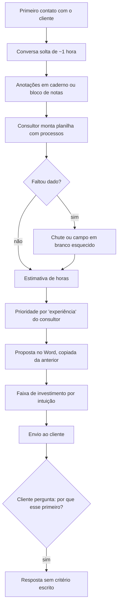
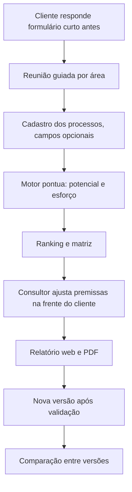

# 06 · Processo atual (AS-IS) do diagnóstico

Como a Atalho faz hoje, segundo as reuniões simuladas ([negócio](02-negocio-atalho.md)):

**Pontos de dor:** B (falta de roteiro), F (dado faltante invisível), H (critério implícito), J (faixa sem base), M (sem explicação).

## TO-BE com o Mapa

Cada ponto de dor tem resposta: roteiro (B), completude visível (F), critérios e pesos documentados (H), faixa calculada com premissas (J), nota por critério no ranking (M).
