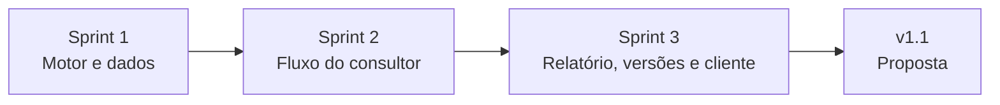

# Backlog em 3 sprints

> **Nota de honestidade.** As sprints são uma forma de organizar o backlog por dependência e valor. Não finjo um calendário de duas semanas por sprint: o trabalho foi feito de forma contínua, e os commits seguem esta ordem. Cada [review](../05-qualidade/sprint-1-review.md) registra o que foi entregue e o que deu errado.

| Sprint | Meta | Histórias | Requisitos |
|---|---|---|---|
| **1 · Motor e dados** | A pontuação funciona, é testada e tem dados para demonstrar | US-13 (parcial: dados), base de US-04, US-05, US-06 | RF-05, RF-06, RF-07, RF-08, RF-16, RNF-01, RNF-04, RN-01 a RN-09 |
| **2 · Fluxo do consultor** | Do login ao ranking e à edição de premissas, com dado faltante | US-01, US-02, US-03, US-04, US-05, US-06, US-10 | RF-01 a RF-04, RF-09, RF-13, RNF-02, RNF-03 |
| **3 · Relatório, versões e cliente** | Relatório web e PDF, versões, formulário do cliente e evidências | US-07, US-08, US-09, US-11, US-12 | RF-10, RF-11, RF-12, RF-14, RF-15, RNF-05 |
| **v1.1** | Evolução pedida na retrospectiva | US-14 | RF-17 |

## Ordem de corte, se o tempo apertasse

Definida de antemão, do primeiro a ser cortado ao último: **v1.1 → guias → E2E → resumo por IA → formulário do cliente → retrospectiva.** Nunca cortar: documentos de descoberta e definição, metodologia, motor de pontuação, relatório PDF, prints e README. Nada foi cortado.

## Definição de pronto de cada item

1. Critérios de aceite da história verificados.
2. Regra de negócio coberta por teste (unitário ou integração) quando houver cálculo.
3. `tsc` e `eslint` sem avisos.
4. Commit em Conventional Commits citando os IDs.
