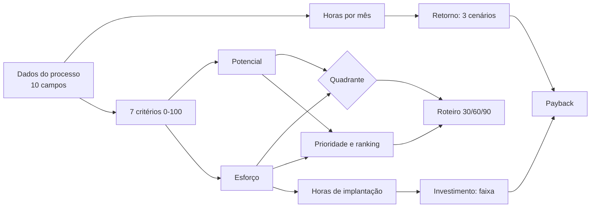

# Episódio 3 — Metodologia

Este é o centro da série: como cada processo recebe nota de potencial e de esforço, com critérios, pesos e fórmulas escritos e contas conferidas à mão.
A economia sai como faixa de três cenários, e dado faltante entra com valor cauteloso, nunca zero.
A análise de sensibilidade mostra o que muda quando as premissas mudam, e a lista de limitações diz o que a ferramenta não sabe.

| Documento | O que contém | Itens |
|---|---|---|
| [Metodologia de pontuação](#metodologia-de-pontuação) | Critérios, pesos, fórmulas, quadrantes e roteiro 30/60/90 | 7 critérios |
| [Exemplos de cálculo](exemplos-de-calculo.md) | Três contas passo a passo, com processo de referência e dado faltante | 3 exemplos |
| [Sensibilidade](sensibilidade.md) | Variação de premissas e do corte de potencial; comparação v1 × v2 | 2 versões comparadas |
| [Limitações](limitacoes.md) | O que a ferramenta não mede nem sabe | 15 limitações |

[← Anterior](../02-definicao/README.md) · [Índice](../INDEX.md) · [Próximo →](../04-arquitetura/README.md)

---

# Metodologia de pontuação

Este é o documento central do projeto. Aqui explico **o que o Mapa calcula, com que critérios, por que escolhi cada peso e onde a conta pode errar**. Toda fórmula descrita está implementada em [`src/lib/scoring`](../../src/lib/scoring) e coberta por testes ([relatório de testes](../05-qualidade/relatorio-de-testes.md)).

> **Aviso de honestidade.** Os cortes e pesos abaixo são **julgamento meu**, fundamentado em raciocínio, e **não foram calibrados com dados reais**. O Mapa é um instrumento para **organizar uma conversa e tornar o critério explícito**; não é um oráculo. Por isso são configuráveis ([ADR-002](../04-arquitetura/adr-002-criterios-configuraveis.md)) e há [análise de sensibilidade](sensibilidade.md).

## Visão geral em uma página

1. **Horas por mês** = execuções por mês × minutos por execução × pessoas ÷ 60.
2. **Sete critérios**, cada um de 0 a 100: frequência, volume, repetitividade, impacto (alimentam o *potencial*) e digitalização, facilidade de integração, risco (alimentam o *esforço*).
3. **Potencial** e **esforço** são médias ponderadas dos critérios. Combinados, dão o **quadrante** e a **prioridade**.
4. **Retorno** vem das horas, do custo da hora e de uma redução esperada, em três cenários. **Investimento** vem do esforço. **Payback** é investimento ÷ economia.
5. O **roteiro 30/60/90** encaixa os processos em janelas de capacidade.

## Execuções por mês

| Frequência | Execuções/mês | Por quê |
|---|---|---|
| Diária | 22 | Dias úteis de um mês |
| Semanal | 4,33 | 52 ÷ 12 |
| Quinzenal | 2 | |
| Mensal | 1 | |
| Eventual | 0,5 | Uma vez a cada dois meses; premissa conservadora |

## Os sete critérios (RN-01)

### Frequência → potencial
Mais execuções por mês, mais vezes o ganho se repete.

| Execuções/mês | Nota |
|---|---|
| ≥ 20 | 100 |
| ≥ 8 | 80 |
| ≥ 4 | 60 |
| ≥ 2 | 40 |
| ≥ 1 | 25 |
| < 1 | 10 |

### Volume → potencial
Itens por mês (execuções × itens por execução). Volume alto dilui o custo fixo de automatizar.

| Itens/mês | Nota |
|---|---|
| ≥ 1000 | 100 |
| ≥ 300 | 80 |
| ≥ 100 | 60 |
| ≥ 30 | 40 |
| < 30 | 20 |

### Repetitividade → potencial
É a **padronização** informada (1 a 5), convertida: nota = (valor − 1) ÷ 4 × 100. Só se automatiza bem o que já tem um jeito único.

### Impacto → potencial
Mistura **tempo** (75%) e **erro** (25%).

- Nota de tempo por horas/mês: ≥ 100 → 100; ≥ 50 → 80; ≥ 20 → 60; ≥ 8 → 40; senão 20.
- Nota de erro = taxa de erro × 4, limitada a 100 (25% de erro já satura).
- Impacto = 0,75 × tempo + 0,25 × erro.

### Digitalização → esforço (invertida)
Dado em papel precisa ser digitado antes de automatizar. Nota = (valor − 1) ÷ 4 × 100; no esforço entra como (100 − nota).

### Facilidade de integração → esforço (invertida)
Média das notas (1 a 5) das ferramentas, convertida para 0 a 100. Catálogo editável:

| Ferramenta | Nota | | Ferramenta | Nota |
|---|---|---|---|---|
| Google Sheets / planilha online | 5 | | ERP | 3 |
| CRM | 4 | | Excel | 3 |
| E-mail | 4 | | Sistema de prontuário | 3 |
| WhatsApp Business | 4 | | WhatsApp (celular) | 2 |
| Sistema de agenda | 4 | | Sistema legado | 1 |
| | | | Papel | 1 |

Ferramenta fora do catálogo recebe **2,5** e é sinalizada no ranking e no relatório. Sem ferramentas informadas: 2,5.

### Risco → esforço
Risco = dado sensível + dependências, limitado a 100.

- Dado sensível: nenhum 0; dados pessoais 40; saúde ou financeiro 70.
- Dependências: 6 pontos cada, até 5 (máx. 30).

## Potencial e esforço (RN-02, RN-03)

**Potencial** = 0,20 × frequência + 0,15 × volume + 0,25 × repetitividade + 0,40 × impacto

**Esforço** = 0,35 × (100 − digitalização) + 0,35 × (100 − integração) + 0,30 × risco

### Por que esses pesos

Esta é a decisão mais subjetiva do projeto; descrevo o raciocínio para você poder discordar.

- **Impacto 40%.** É o que efetivamente paga o projeto: horas devolvidas e erros evitados. É o maior peso porque, sem impacto, o resto não importa.
- **Repetitividade 25%.** É o segundo maior porque **não se automatiza bem o que não tem um jeito único**. Um processo de alto impacto mas caótico costuma exigir primeiro padronizar (trabalho de gente, não de software).
- **Frequência 20% e volume 15%.** Importam, mas já estão parcialmente contidos no impacto (mais frequência, mais horas). Por isso pesam menos, para não contar o mesmo fato duas vezes. Volume pesa menos que frequência porque um volume alto numa tarefa rara rende pouco ao longo do mês.
- **Digitalização e integração 35% cada.** São os dois maiores determinantes técnicos de esforço: onde estão os dados e se dá para conectar às ferramentas.
- **Risco 30%.** Pesa quase igual aos técnicos porque, em saúde e finanças, o risco de dado sensível muda *como* se constrói (revisão humana, acesso, auditoria), não só quanto custa.

**Quando eu mudaria os pesos:** se, em projetos reais, processos com muita repetição e pouco impacto individual se mostrassem melhores do que o ranking indica, eu subiria frequência e volume. Se processos "bonitos no papel" falhassem por falta de padronização, subiria repetitividade. A análise de sensibilidade e a configurabilidade existem para esse ajuste.

**Alternativas que considerei:** (a) pesos iguais: simples, mas trata como equivalentes coisas que não são; (b) regressão com dados históricos: o ideal, mas não tenho dados; (c) escolher por julgamento, documentar e deixar editável: **a escolha**, honesta sobre o que sei.

## Quadrantes (RN-04)

Cortes: potencial ≥ 50 é "alto"; esforço < 50 é "baixo". O ponto médio é intuitivo e mantém a explicação simples ao cliente. Se você mexer no corte, a [análise de sensibilidade](sensibilidade.md) mostra o efeito: com corte de potencial em 60, "começar já" cai de 2 para 1 processo.

## Prioridade e ranking (RN-05)

**Prioridade** = 0,6 × potencial + 0,4 × (100 − esforço). O potencial pesa mais porque o retorno é o motivo do projeto, mas um esforço alto pune. Ranking em ordem decrescente; empate por mais horas/mês e depois por nome (para o resultado ser estável).

## Retorno (RN-06)

**Economia mensal = horas por mês × custo da hora × redução esperada**

| Cenário | Redução | Ajuste por dado faltante |
|---|---|---|
| Conservador | 40% | × (0,7 + 0,3 × completude) |
| Realista | 60% | × (0,85 + 0,15 × completude) |
| Otimista | 80% | nenhum |

- **Custo da hora** padrão R$ 42 (salário com encargos ÷ horas trabalhadas, valor plausível; editável).
- **Faixa de incerteza.** Os três cenários são a faixa. Onde faltam dados, o conservador cai mais que o realista e o otimista não muda, o que **alarga a faixa para baixo**: a incerteza é mostrada, não escondida. Com completude 1, não há ajuste.
- A redução (40/60/80%) é **premissa**, não medição. Nada na ferramenta afirma que a automação "reduz X%".

## Investimento e payback (RN-06)

- **Horas de implantação** = 16 + (esforço ÷ 100) × (120 − 16). De 16 h (esforço 0) a 120 h (esforço 100).
- **Investimento base** = horas × R$ 150/h.
- **Faixa** = de 85% a 140% do base. A assimetria é intencional: projetos de software estouram mais do que encurtam.
- **Payback** = investimento ÷ economia mensal. Pareando extremos: conservador (investimento alto ÷ economia baixa), otimista (investimento baixo ÷ economia alta).

## Dado faltante (RN-08)

Veja a [tabela de valores cautelosos](../02-definicao/regras-de-negocio.md#como-tratar-dado-faltante-rn-08-em-uma-tabela). O princípio: **nunca zero, sempre cauteloso, sempre visível**.

## Roteiro 30/60/90 (RN-07)

Capacidade padrão: 80 horas de implantação por janela de 30 dias. Ordem de entrada: *Começar já* (por prioridade), depois *Planejar* (só a partir da janela 2, depois de desenhado), depois *Oportunista*. Um item maior que a janela atravessa janelas seguidas. Se não fecha em 90 dias, vai para "depois dos 90 dias". Os valores de capacidade são premissa do consultor.

## Ajustando a metodologia

Pesos, cortes e catálogo de ferramentas são valores de `ScoringConfig`, guardados **por versão do diagnóstico**. A tela de premissas edita o retorno, o investimento e a capacidade; os pesos ficam no código padrão neste MVP (a edição dos pesos pela tela está no [roadmap](../06-pos-lancamento/roadmap.md)). `validateConfig` recusa pesos que não somem 1.

## De onde vêm os paybacks

- **15,3 meses** (relatório e [sensibilidade](sensibilidade.md)): investimento realista somado ÷ economia mensal realista somada, sobre todos os processos fora do quadrante *Evitar* (`summarize`, em `src/lib/scoring/summary.ts`).
- **13,9 meses** (seção 7 do relatório, pré-escopo): a mesma divisão, só sobre os processos em *Começar já* e *Planejar*, que formam o escopo sugerido (`src/components/ReportView.tsx`).
- **9,1 meses** (proposta v1.1): a mesma divisão, mas só sobre os processos que couberam nos 90 dias do roteiro (`src/lib/proposal.ts`); por isso difere do relatório.
- **Payback de cada processo:** investimento ÷ economia mensal do próprio processo, por cenário (`src/lib/scoring/engine.ts`).

## Onde seguir

- [Exemplos de cálculo passo a passo](exemplos-de-calculo.md)
- [Análise de sensibilidade](sensibilidade.md)
- [O que a ferramenta não sabe](limitacoes.md)
