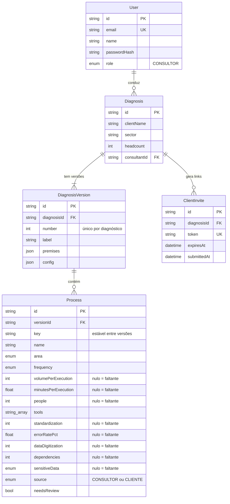
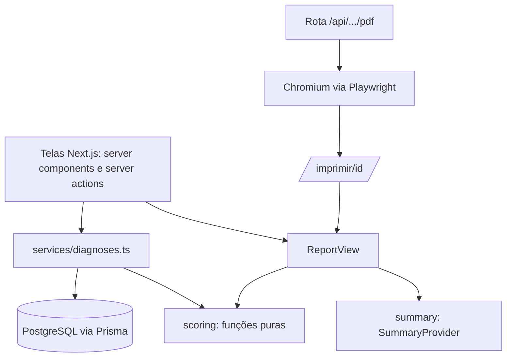

# Modelo de dados e arquitetura

Fonte: [`prisma/schema.prisma`](../../prisma/schema.prisma).

## Decisões de modelagem

- **Nulo significa dado faltante** (RN-08). Nunca se grava 0 no lugar de "não sei"; a validação converte campo vazio em `null`.
- **Resultados não são gravados.** Potencial, esforço, ranking e retorno são **calculados** a cada leitura a partir dos dados e da configuração da versão. Alternativa seria gravar o resultado; descartei porque isso criaria duas fontes da verdade que poderiam divergir após uma correção no motor. Trade-off: recalcular a cada tela (barato para dezenas de processos). Mudaria se houvesse milhares de processos.
- **Premissas e configuração em JSON na versão**, para reproduzir relatórios antigos (ADR-002, ADR-004).
- **`Process.key`** liga o "mesmo" processo entre versões.

## Camadas

A pontuação não conhece banco, rede nem Next.js: é a parte mais fácil de testar e a única que decide ranking e retorno.
