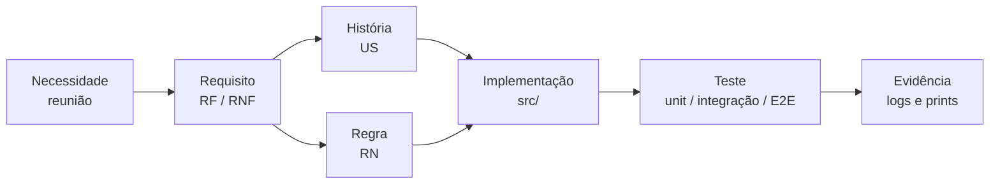

# 03 · Requisitos e rastreabilidade

[← Índice do ciclo de vida](README.md) · Anterior: [02 · Planejamento e Scrum](02-planejamento-e-scrum.md) · Próximo: [04 · Arquitetura e ADRs](04-arquitetura-e-adrs.md)

Esta página integra os documentos de [definição](../02-definicao/requisitos.md): 17 requisitos funcionais, 7 não funcionais, 12 regras de negócio e 14 histórias. Aqui está o caminho da necessidade ao teste. A tabela completa de requisito → código → teste está em [rastreabilidade](../02-definicao/rastreabilidade.md).

## Das necessidades aos requisitos

| Necessidade (reunião simulada) | Requisito | História | Regra | Decisão |
|---|---|---|---|---|
| Sócio: reunião de uns 45 minutos e um número de economia | RF-08, RF-10, RF-14 | US-06, US-07, US-11 | RN-06 | Resumo no topo com valor realista e faixa ao lado |
| Analista: dez campos por processo e rastreabilidade | RF-03, RF-04, RF-06 | US-03, US-04 | RN-08 | Só a frequência é obrigatória; completude visível |
| Dono da clínica: dado de paciente não sai da máquina | RNF-04, RF-14, RF-15 | US-11, US-12 | RN-10, RN-12 | Tudo local; IA só com números agregados; formulário só de escrita |
| Cliente: entender a ordem sem sigla | RF-07, RF-10 | US-05 | RN-04 | Quadrantes com nomes em português |
| Consultor: mostrar o que mudou depois da validação | RF-12 | US-09 | RN-11 | Versão como retrato completo |
| Consultor: levar o diagnóstico à proposta | RF-17 | US-14 | RN-06, RN-07 | Escopo da proposta igual ao roteiro de 90 dias |

## Cadeia de rastreabilidade

*Cada elo tem tabela própria: [histórias](../02-definicao/historias.md), [regras](../02-definicao/regras-de-negocio.md), [rastreabilidade](../02-definicao/rastreabilidade.md) e [relatório de testes](../05-qualidade/relatorio-de-testes.md).*

## Exemplo percorrido: dado faltante (RN-08)

| Elo | Registro |
|---|---|
| Necessidade | Analista quer profundidade; sócio não quer travar a conversa quando o cliente não sabe ([reunião 2](../01-discovery/04-reuniao-analista.md)) |
| Requisito | RF-04: aceitar campo em branco como dado faltante, sinalizar a lacuna e nunca tratar como zero |
| História | US-03: cadastrar processo sem todos os dados; critérios de aceite em [histórias](../02-definicao/historias.md) |
| Regra | RN-08: valor cauteloso, lista de campos faltantes, completude reduzida e faixa alargada ([tabela](../02-definicao/regras-de-negocio.md#como-tratar-dado-faltante-rn-08-em-uma-tabela)) |
| Implementação | `src/lib/scoring/engine.ts` (`missingFields`, `completeness`) e `src/lib/validation.ts` (vazio vira `null`) |
| Teste | unitário "dado faltante"; integração "campos vazios como null"; E2E "falta: taxa de erro" |
| Resultado | Na comparação v1 × v2 o dado faltante mudou o primeiro colocado ([sensibilidade](../03-metodologia/sensibilidade.md)) |

## Partes interessadas e responsabilidades (RACI)

R = executa, A = responde pelo resultado, C = consultado, I = informado. Os papéis são do cenário do estudo de caso.

| Atividade | Consultor responsável pelo produto | Sócio-consultor | Analista | Dono da clínica |
|---|---|---|---|---|
| Definir critérios e pesos | R, A | C | C | I |
| Levantar processos | R | C | C | C |
| Validar wireframes e decisões | R, A | C | C | C |
| Aceitar o MVP | R | A | C | I |
| Restrição de dados de paciente | R | C | C | A |

## Critérios de aceite dos principais fluxos

| Fluxo | Critério | Verificação |
|---|---|---|
| Cadastro | Só nome, área e frequência obrigatórios; vazio vira dado faltante | integração e E2E |
| Ranking | Ordenado por prioridade; cada linha abre as 7 notas | unitário e E2E |
| Relatório | Oito seções; PDF igual à página de impressão | E2E (`%PDF-`, login exigido) |
| Versões | Só a mais recente é editável; comparação por chave estável | integração e E2E |
| Link do cliente | Expira em 14 dias, só escreve, marca "revisar" | integração e E2E |

## Registro de mudanças

Fonte: [reunião de validação](../04-arquitetura/reuniao-validacao.md), com decisões e motivos.

| # | Pedido | Decisão |
|---|---|---|
| 1 | Número de economia no topo do relatório | Aceito |
| 2 | Nota de cada critério no ranking | Aceito |
| 3 | Nomes de quadrante sem sigla | Aceito |
| 4 | Editar pesos pela tela | Adiado (roadmap v1.2) |
| 5 | Cliente ver o relatório pelo link | Aceito parcialmente: link só de escrita, relatório em PDF |
| 6 | Nome de cada processo no gráfico | Alterado: pontos numerados e lista ao lado |
| 7 | Mostrar o que ficou fora e por quê | Aceito |
| — | IA preencher campos e pontuar sozinha | Recusado ([ADR-001](../04-arquitetura/adr-001-pontuacao-deterministica.md)) |

Mudança posterior: o modelo de proposta (RF-17) entrou na v1.1 por pedido da [retrospectiva](../06-pos-lancamento/retrospectiva-reuniao.md).
