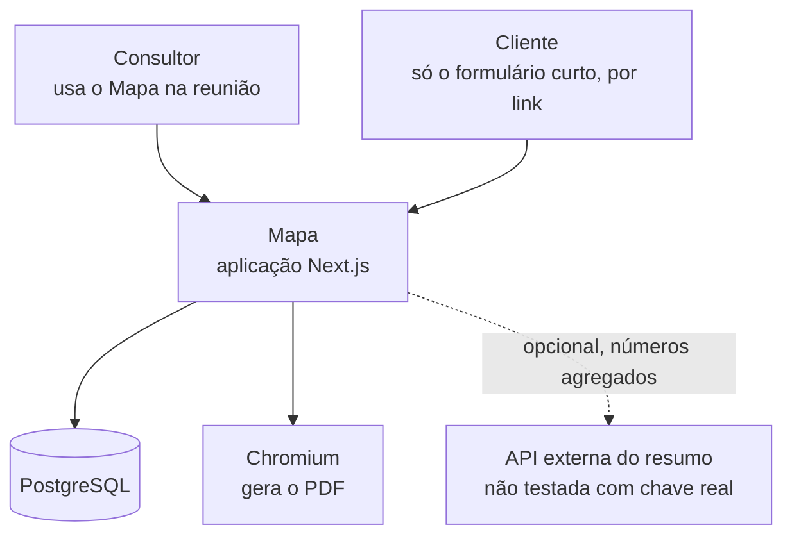
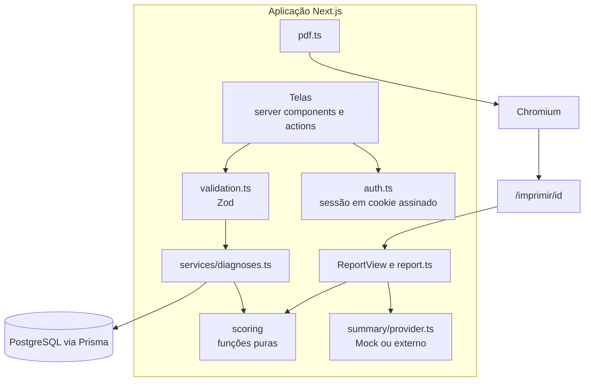
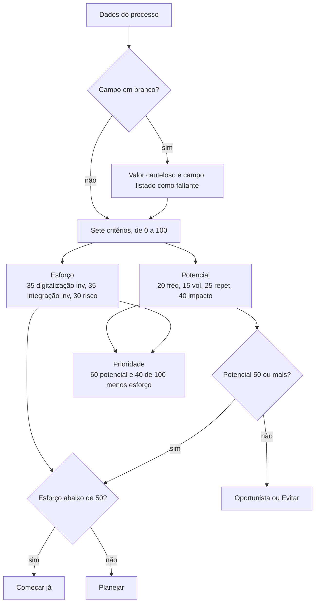

# 04 · Arquitetura e ADRs

[← Índice do ciclo de vida](README.md) · Anterior: [03 · Requisitos e rastreabilidade](03-requisitos-e-rastreabilidade.md) · Próximo: [05 · Modelo de dados](05-modelo-de-dados.md)

Integra a documentação de [arquitetura](../04-arquitetura/README.md). Os diagramas descrevem o código atual da `main`.

## Contexto do sistema

*O consultor e o cliente são as duas formas de acesso. A API externa é opcional; sem chave, o resumo vem do `MockProvider`.*

## Contêineres e componentes

| Componente | Responsabilidade | Dependências |
|---|---|---|
| `src/lib/scoring` | Pontuação, ranking, retorno, roteiro e comparação; sem I/O | nenhuma de banco ou rede (RNF-01) |
| `src/lib/services/diagnoses.ts` | Casos de uso sobre diagnósticos, versões, processos e convites | Prisma, scoring |
| `src/lib/validation.ts` | Valida entrada no servidor; vazio vira `null` | Zod |
| `src/lib/auth.ts` | Hash de senha, sessão assinada, exigência de login | bcryptjs, jose |
| `src/lib/pdf.ts` | Renderiza a página de impressão em PDF A4 | Playwright |
| `src/lib/summary/provider.ts` | Resumo opcional com fallback | API externa, mock |

## Decisão de pontuação (ADR-001)

A pontuação é uma sequência fixa de regras: a mesma entrada produz sempre a mesma saída.

*Pesos conforme RN-02 a RN-05 em [regras de negócio](../02-definicao/regras-de-negocio.md). No quadrante de baixo potencial, esforço baixo dá Oportunista e esforço alto dá Evitar.*

## Sequência do fluxo principal

Levantamento → cadastro → ranking → matriz → relatório → proposta. O diagrama de sequência do cadastro ao PDF está em [sequência do relatório](../04-arquitetura/sequencia-relatorio.md). A proposta usa o mesmo cálculo, restrito ao escopo que coube nos 90 dias.

## ADRs

| ADR | Decisão | Alternativas consideradas | Custo aceito |
|---|---|---|---|
| [001](../04-arquitetura/adr-001-pontuacao-deterministica.md) | Pontuação por regras, IA só redige texto opcional | IA pontua; híbrido | Menos flexibilidade com texto livre |
| [002](../04-arquitetura/adr-002-criterios-configuraveis.md) | Pesos e premissas em objetos tipados, guardados por versão | Valores fixos no código; tudo configurável pela interface | Pesos só editáveis no código ou no JSON da versão |
| [003](../04-arquitetura/adr-003-geracao-de-pdf.md) | PDF pela própria página de impressão, via Chromium | react-pdf; imprimir pelo navegador | Depende de Chromium instalado; geração mais lenta |
| [004](../04-arquitetura/adr-004-versoes.md) | Versão como retrato completo e imutável | Sem versões; log de alterações por campo | Duplica dados e perde o histórico campo a campo |
| [005](../04-arquitetura/adr-005-link-do-cliente.md) | Link com token, validade de 14 dias e só escrita | Conta para o cliente; link público fixo | Link vazado permite lixo por até 14 dias |

## Requisitos de qualidade

| Atributo | Como é tratado | Limite conhecido |
|---|---|---|
| Segurança | Hash de senha, cookie httpOnly assinado, isolamento entre consultores, token com expiração | Sem limite de tentativas de login |
| Desempenho | Resultados calculados na leitura, sem gravar; 500 processos sintéticos ordenados em teste unitário | Sem benchmark de carga |
| Disponibilidade | Falha do PDF devolve 502 com mensagem e mantém o relatório web | Queda do banco não testada |
| Manutenibilidade | TypeScript estrito e lint sem avisos | Cobertura medida só em `src/lib/scoring` |
| Observabilidade | Mensagens de erro em português; sem logs estruturados | Sem monitoramento |

Modos de falha F-1 a F-13: [modos de falha](../04-arquitetura/modos-de-falha.md).
