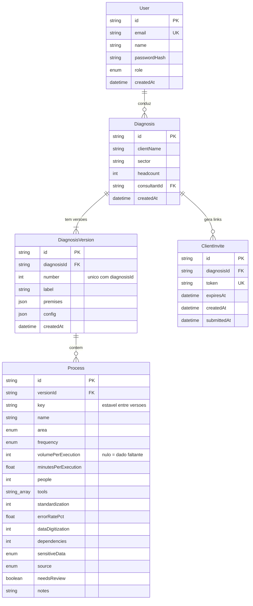
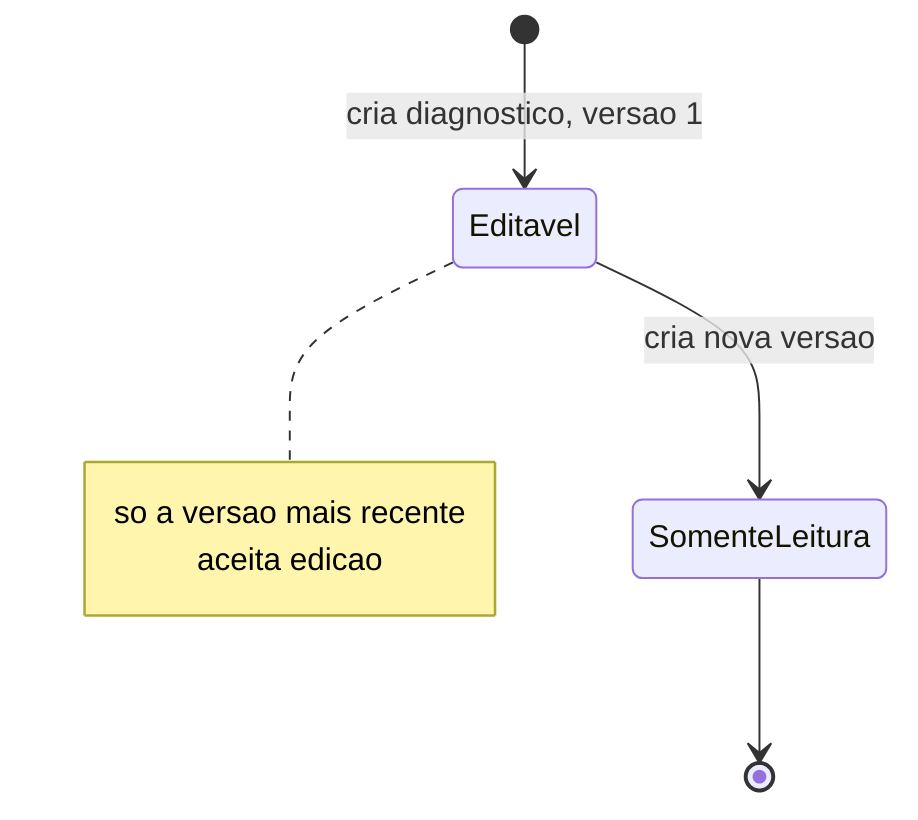
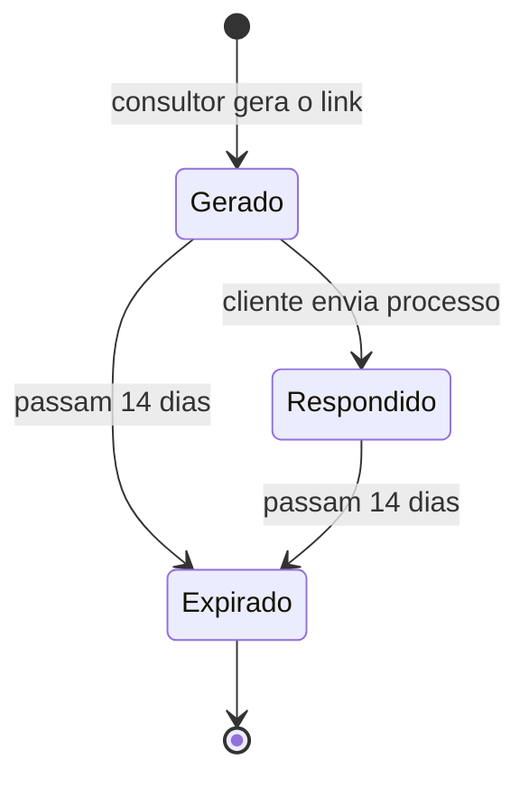

# 05 · Modelo de dados

[← Índice do ciclo de vida](README.md) · Anterior: [04 · Arquitetura e ADRs](04-arquitetura-e-adrs.md) · Próximo: [06 · Desenvolvimento e configuração](06-desenvolvimento-e-configuracao.md)

Fonte: `prisma/schema.prisma` (PostgreSQL). O diagrama e as tabelas descrevem o schema atual da `main`. Detalhes de camadas em [modelo ER e camadas](../04-arquitetura/modelo-er.md).

## Modelo entidade-relacionamento

*Os campos de `Process` com `?` no schema aceitam nulo; nulo significa dado faltante (RN-08).*

## Dicionário de dados

| Entidade | Atributo | Tipo | Obrigatório | Observação |
|---|---|---|---|---|
| User | email | texto único | sim | Login do consultor |
| User | passwordHash | texto | sim | Hash bcrypt; senha nunca é gravada |
| User | role | enum `CONSULTOR` | sim | Único papel |
| Diagnosis | clientName, sector, headcount | texto, texto, inteiro | sim | Cadastro do cliente |
| Diagnosis | consultantId | FK para User | sim | Isolamento entre consultores |
| DiagnosisVersion | number | inteiro | sim | Único por diagnóstico |
| DiagnosisVersion | premises, config | JSON | sim | Premissas de retorno e pesos, por versão (ADR-002) |
| Process | key | texto | sim | Identidade estável, usada na comparação (RF-12) |
| Process | area | enum | sim | `COMERCIAL`, `ATENDIMENTO`, `FINANCEIRO`, `OPERACAO`, `RH` |
| Process | frequency | enum | sim | `DIARIA`, `SEMANAL`, `QUINZENAL`, `MENSAL`, `EVENTUAL` |
| Process | volumePerExecution, minutesPerExecution, people, standardization, errorRatePct, dataDigitization, dependencies, sensitiveData | numérico ou enum | não | Nulo = dado faltante |
| Process | tools | lista de texto | sim | Vazia conta como campo faltante |
| Process | source, needsReview | enum, booleano | sim | `CLIENTE` e `needsReview` marcam resposta do formulário |
| ClientInvite | token | texto único | sim | 24 bytes aleatórios em base64url |
| ClientInvite | expiresAt, submittedAt | data | expiresAt sim | Validade de 14 dias; `submittedAt` nulo até o envio |

Os limites de valor (padronização de 1 a 5, taxa de erro de 0 a 100 e outros) são validados no servidor por Zod em `src/lib/validation.ts`; o banco não tem restrições de faixa.

## Integridade, índices e transações

| Mecanismo | Onde | Função |
|---|---|---|
| Chave única `(diagnosisId, number)` | DiagnosisVersion | Impede duas versões com o mesmo número |
| Chave única | User.email, ClientInvite.token | Login e busca do convite por token |
| Índice | Process.versionId | Carregar os processos de uma versão |
| `onDelete: Cascade` | Versões, processos e convites | Excluir o diagnóstico remove tudo que depende dele |
| `$transaction` no envio do formulário do cliente | `submitClientProcess` em `services/diagnoses.ts` | O processo e a marca de convite respondido são gravados juntos (modo de falha F-4) |

## Versionamento como retrato (ADR-004)

Criar uma versão copia premissas, configuração e processos da última. Só a mais recente é editável; as anteriores ficam somente leitura. A `key` de cada processo atravessa as versões, e a comparação usa essa chave.

*Estados de uma versão. A nova versão nasce editável e a anterior passa a retrato imutável.*

## Acesso por token (ADR-005)

*O link só acrescenta processos à versão mais recente, marcados `needsReview`, e não exibe nenhum dado existente. Link inexistente ou expirado mostra uma página neutra e nada é gravado (F-8).*

## Seeds e dados de demonstração

`prisma/seed.ts` cria o consultor e a Clínica Vida Plena em duas versões: a v1 com 12 processos e dado faltante, e a v2 com 14 processos completos. Os dados são fictícios e servem de base aos testes E2E, aos prints e aos PDFs de exemplo.

## O que não existe no schema

- Migrations: o projeto usa `prisma db push`, sem pasta `prisma/migrations`.
- Auditoria por campo, política de retenção e exclusão de dados do cliente: não implementadas.
- Campo para dado de paciente: não há. O formulário do cliente avisa para não informar esse tipo de dado.
