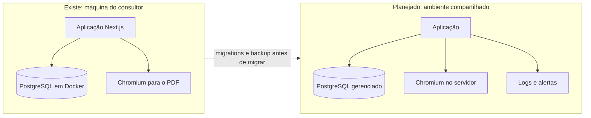

# 08 · Implantação e operação

[← Índice do ciclo de vida](README.md) · Anterior: [07 · Testes e qualidade](07-testes-e-qualidade.md) · Próximo: [09 · Evolução e roadmap](09-evolucao-e-roadmap.md)

Esta página separa o que existe do que é plano. **Existe:** execução local com Docker Compose, seed, scripts de PDF e de limpeza, e o roteiro para rodar em [CONTRIBUTING.md](../../CONTRIBUTING.md). **Não existe:** deploy de aplicação, ambiente de homologação ou produção, monitoramento, alertas e usuários reais. Tudo que vem depois da primeira tabela é plano do estudo de caso.

| Item | Situação |
|---|---|
| Ambiente local (aplicação, PostgreSQL em Docker, Chromium) | Existe |
| Seed da Clínica Vida Plena e script de limpeza da demonstração | Existe |
| Homologação e produção | Planejado |
| Migrations, backup, monitoramento, alertas | Planejado |
| Treinamento e suporte | Planejado |

## Arquitetura de implantação planejada

*Do ambiente local, que existe, ao compartilhado, que é plano. O Mapa tem restrição de dados do cliente: qualquer ambiente compartilhado exige antes a decisão sobre o contrato de operador de dados ([reunião 3](../01-discovery/05-reuniao-dono-clinica.md)).*

## Ambientes e configuração

| Ambiente | Banco | Configuração |
|---|---|---|
| Desenvolvimento (existe) | `mapa`, porta 5433 | `.env` a partir do `.env.example` |
| Teste (existe) | `mapa_test` | Mesmo servidor, banco separado |
| Homologação e produção (planejado) | Instância própria | Variáveis de ambiente do provedor; `SESSION_SECRET` com 32 caracteres ou mais |

Dependências externas: Chromium (PDF) e, de forma opcional, a API externa do resumo, que não foi testada com chave.

## Plano de implantação (planejado)

1. Adotar migrations Prisma e gerar a baseline do schema atual.
2. Subir homologação com o seed e rodar a suíte E2E contra ela.
3. Piloto com um consultor e um diagnóstico real autorizado pelo cliente.
4. Liberar para os demais consultores depois de revisar o piloto.

## Rollback (planejado)

Cada release tem tag. O retorno é reimplantar a tag anterior. Como `prisma/` não mudou entre `v1.0.0` e `v1.1.0`, esse retorno não exigiria reverter o schema. Mudanças futuras de schema precisam de migration reversível ou backup prévio.

## Migração e preparação de dados

Não há dados reais a migrar. Para uma consultoria que já tem diagnósticos em planilha, o caminho previsto é importar processos pelo formulário do cliente ou por script, com revisão do consultor (`needsReview`).

## Treinamento, documentação e suporte (planejado)

| Ação | Material existente |
|---|---|
| Treinar o consultor no roteiro | [perguntas-chave](../01-discovery/perguntas-chave.md) e [galeria de prints](../screenshots/README.md) |
| Ensinar a ler o relatório | [exemplo de relatório](../exemplo-de-relatorio/README.md) e a seção "O que este relatório não sabe" |
| Explicar a pontuação ao cliente | [metodologia](../03-metodologia/README.md) e [exemplos de cálculo](../03-metodologia/exemplos-de-calculo.md) |
| Suporte | Canal a definir; sem SLA |

## Monitoramento e adoção

Hoje não há logs estruturados nem alertas. Indicadores de adoção planejados, todos hipóteses a validar com uso real ([H-1 a H-4](../02-definicao/riscos.md)):

| Indicador | Hipótese | Como medir |
|---|---|---|
| Tempo de preparação do diagnóstico | H-1 | Cronometrar 5 diagnósticos com e sem o Mapa |
| Clareza da ordem para o cliente | H-2 | Perguntar ao fim da reunião se entendeu |
| Propostas com valor fora da realidade | H-3 | Comparar a faixa estimada com o custo final |
| Duração da reunião | H-4 | Comparar com e sem formulário prévio |

## Riscos operacionais

| Risco | Efeito | Mitigação |
|---|---|---|
| Chromium ausente | PDF não sai | 502 com mensagem; relatório web segue (F-1) |
| Banco indisponível | Erro 500 | Sem tratamento além do erro (F-4) |
| Segredo de sessão ausente | Login não funciona | Erro explícito de configuração (F-11) |
| Link do cliente vazado | Processos indevidos por até 14 dias | Só escreve; consultor revisa o que entra ([ADR-005](../04-arquitetura/adr-005-link-do-cliente.md)) |
| Sem backup | Perda de dados | Planejado junto das migrations |
