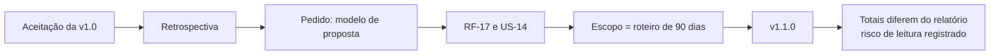

# 09 · Evolução e roadmap

[← Índice do ciclo de vida](README.md) · Anterior: [08 · Implantação e operação](08-implantacao-e-operacao.md) · Voltar à [capa](../../README.md)

## Histórico de versões

| Versão | Conteúdo | Registro |
|---|---|---|
| v1.0.0 | MVP: motor de pontuação, fluxo do consultor, relatório web e PDF, versões, formulário do cliente, seed e prints | [CHANGELOG](../../CHANGELOG.md), [relatório de testes](../05-qualidade/relatorio-de-testes.md) |
| v1.1.0 | Modelo de proposta a partir do diagnóstico (RF-17, US-14); escopo igual ao roteiro de 90 dias | [PR da v1.1](../06-pos-lancamento/pr-v1.1-proposta.md) |
| Após a v1.1.0 (sem tag) | Correções de E2E e de PDF, script `test:coverage`, testes de volume e de sessão | [CHANGELOG](../../CHANGELOG.md), seção "Não lançado" |

## Da v1.0.0 à v1.1.0

*O pedido nasce na [retrospectiva](../06-pos-lancamento/retrospectiva-reuniao.md). A diferença de payback entre proposta (9,1 meses) e relatório (15,3 meses) vem do escopo e está explicada na [metodologia](../03-metodologia/README.md#de-onde-vêm-os-paybacks).*

## Solicitações de mudança e impacto

| Mudança | Origem | Impacto | Estado |
|---|---|---|---|
| Editar pesos pela tela | Analista, na validação | Exige validação visual da soma e explicação de uso | Adiada, roadmap v1.2 |
| Relatório visível pelo link do cliente | Dono da clínica, na validação | Exigiria autenticação do cliente | Parcial: PDF, link só de escrita |
| Modelo de proposta | Sócio, na retrospectiva | Nova aba, sem mudar regra de pontuação | Entregue na v1.1.0 |
| IA pontuando | Sócio, na validação | Perda de explicabilidade e risco de privacidade | Recusada (ADR-001) |

## Problemas identificados e ações corretivas

Os defeitos, causas e correções estão em [testes e qualidade](07-testes-e-qualidade.md#registro-de-defeitos-e-causa-raiz). Limitações da própria metodologia estão em [15 limitações](../03-metodologia/limitacoes.md).

## Dívida técnica priorizada

| Prioridade | Item | Motivo |
|---|---|---|
| 1 | Workflow de CI com lint, tipos e testes | Hoje a regressão depende de execução manual |
| 2 | Migrations Prisma | Pré-requisito de qualquer ambiente compartilhado |
| 3 | Tabelas legíveis no celular | Limitação da sprint 3 |
| 4 | Limite de tentativas de login e de envios pelo link | Falhas não tratadas em [modos de falha](../04-arquitetura/modos-de-falha.md) |
| 5 | Cobertura além de `src/lib/scoring` | Só o motor tem número |

## Roadmap

Fonte: [roadmap](../06-pos-lancamento/roadmap.md), ordenado por valor e dependência.

| Versão | Itens | Por quê |
|---|---|---|
| v1.2 | Pesos e cortes pela tela; sensibilidade de pesos; aviso quando cenários colapsam | Pedido da analista e lacuna da análise de sensibilidade |
| v1.3 | Tabelas no celular; limite de tentativas; acessibilidade automatizada | Limitações da sprint 3 e modos de falha |
| v1.4 | Testes dos caminhos de erro | Lacunas do relatório de testes |
| v2.0 | Ciclo de calibração com projetos reais; redução esperada por tipo de processo | Maior fraqueza do método: pesos sem calibração |

## Lições aprendidas

Fonte: [retrospectiva final](../06-pos-lancamento/retrospectiva-final.md).

- Conferir os prints desde o primeiro dia: testes passando não garantiram a tela certa.
- Evitar ajuste de premissas olhando o resultado; o ajuste feito na sprint 1 está registrado como viés.
- Testar os caminhos de erro, não só os felizes.
- Cobertura de 100% não é qualidade: um teste que passava sem checar nada foi reescrito.
- Registrar limitações dentro do produto, na última seção do relatório.

## Melhorias de processo

- CI desde a primeira sprint, para que cada log tenha execução rastreável.
- Cada correção com a causa em uma linha e entrada no CHANGELOG, como feito nas correções de E2E e PDF.
