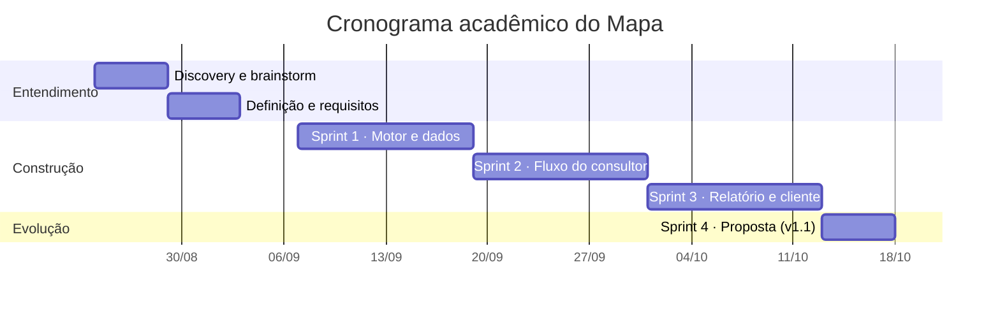

# Ciclo de vida do Mapa

Relatório do ciclo de vida do software, da descoberta do problema à evolução da v1.1. Cada página liga necessidade, requisito, decisão, implementação, teste e resultado. Voltar à [capa](../../README.md) · [índice da série](../INDEX.md) · [glossário](../GLOSSARIO.md).

## Como ler o material

- **Evidência observada:** commits, tags, código, testes e logs do repositório. Datas reais constam em [desenvolvimento e configuração](06-desenvolvimento-e-configuracao.md).
- **Artefato de planejamento:** cronograma, sprints, atas e cerimônias elaborados para o cenário do estudo de caso. A nota de [contexto acadêmico](../../README.md#nota-de-contexto-acadêmico) explica a natureza desses registros.
- **Resultado ilustrativo:** os números do diagnóstico da Clínica Vida Plena são dados criados para o estudo.

## Linha do tempo

Datas do cronograma acadêmico. Commits e tags têm datas próprias e não coincidem com este quadro.

*Fluxo das fases e releases. Os marcos v1.0.0 e v1.1.0 correspondem às tags existentes no repositório.*

## Documentos

| Página | Fase | Conteúdo |
|---|---|---|
| [01 · Visão e discovery](01-visao-e-discovery.md) | Descoberta | Visão, partes interessadas, problema, escopo, restrições |
| [02 · Planejamento e Scrum](02-planejamento-e-scrum.md) | Planejamento | Product Goal, backlog, releases, DoR e DoD, riscos |
| [03 · Requisitos e rastreabilidade](03-requisitos-e-rastreabilidade.md) | Análise | Necessidade → requisito → regra → código → teste |
| [04 · Arquitetura e ADRs](04-arquitetura-e-adrs.md) | Arquitetura | Contexto, contêineres, decisão de pontuação, sequência |
| [05 · Modelo de dados](05-modelo-de-dados.md) | Dados | ER, dicionário, restrições, versões e token |
| [06 · Desenvolvimento e configuração](06-desenvolvimento-e-configuracao.md) | Construção | Git, commits, tags, ausência de CI, dívida técnica |
| [07 · Testes e qualidade](07-testes-e-qualidade.md) | Validação | Estratégia, resultados, defeitos e correções |
| [08 · Implantação e operação](08-implantacao-e-operacao.md) | Operação | O que existe e o que é plano |
| [09 · Evolução e roadmap](09-evolucao-e-roadmap.md) | Evolução | v1.0.0 → v1.1.0, dívida, próximos passos |
| [Reuniões](reunioes/README.md) | Discovery e cerimônias | Atas e registro de reuniões simuladas |
| [Sprints](sprints/README.md) | Scrum | Quatro páginas, uma por sprint |
| [Diagramas](diagramas/README.md) | Visual | Fontes Mermaid editáveis |
