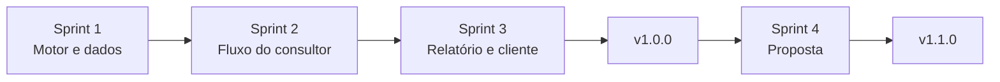

# Sprints

[← Índice do ciclo de vida](../README.md) · [Planejamento e Scrum](../02-planejamento-e-scrum.md)

Cada sprint tem objetivo, escopo, entregáveis, critério de conclusão, planejamento, review e retrospectiva. O período é do cronograma acadêmico; os commits mostram as datas reais. Os resultados de cada review vêm dos documentos de [qualidade](../../05-qualidade/README.md), sem métricas de velocity.

| Sprint | Objetivo | Período acadêmico | Commits |
|---|---|---|---|
| [1 · Motor e dados](sprint-1.md) | Pontuação testada e dados de demonstração | 07/09 a 18/09/2026 | `4bb1719`, `d827b84`, `4e89286` |
| [2 · Fluxo do consultor](sprint-2.md) | Do login ao ranking e às premissas | 21/09 a 02/10/2026 | `4e89286`, `1b90766` |
| [3 · Relatório, versões e cliente](sprint-3.md) | Relatório web e PDF, versões, formulário do cliente | 05/10 a 16/10/2026 | `1b90766`, `4c47ddc`, `fe5d7d7` |
| [4 · Proposta (v1.1)](sprint-4.md) | Modelo de proposta | 19/10 a 23/10/2026 | `6e1651a`, `35782dd` |

