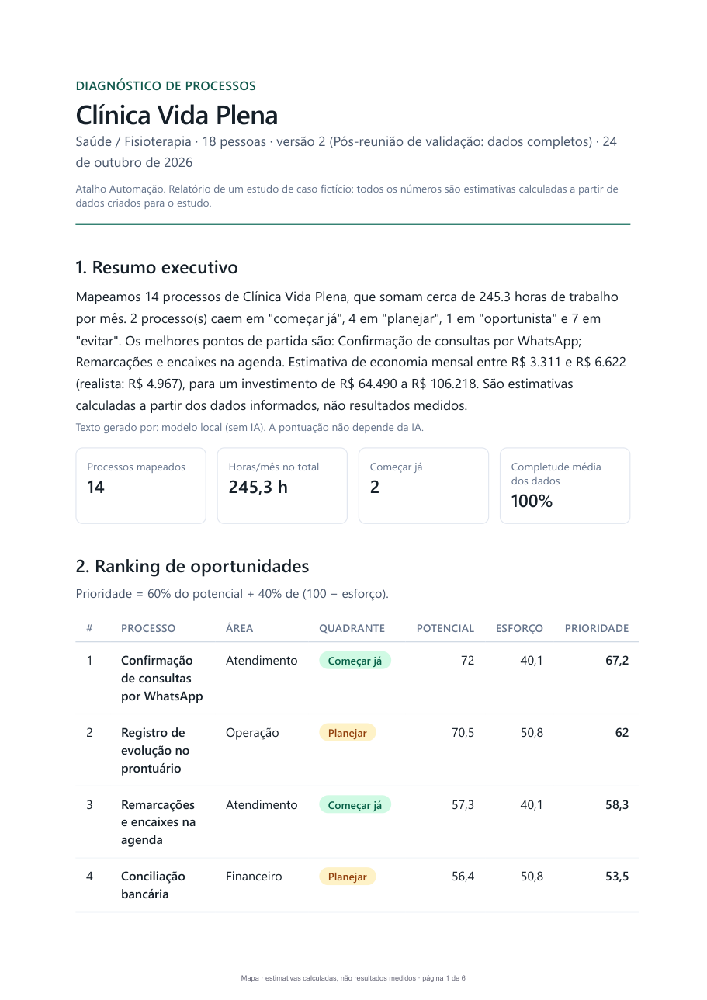

# Exemplo de relatório

Dois PDFs gerados pelo próprio app a partir do seed da Clínica Vida Plena. Todos os números são estimativas calculadas sobre dados fictícios.

| Arquivo | O que mostra |
|---|---|
| [Relatório v2 (PDF)](diagnostico-clinica-vida-plena-v2.pdf) | Versão completa: 14 processos, 245,3 h/mês, economia realista de R$ 4.967/mês, payback realista de 15,3 meses |
| [Relatório v1 (PDF)](diagnostico-clinica-vida-plena-v1.pdf) | Versão com dado faltante: 12 processos, 224,2 h/mês, economia realista de R$ 4.687/mês, payback realista de 15,9 meses |

Os valores de v1 e v2 vêm da tabela de [sensibilidade](../03-metodologia/sensibilidade.md). Na v1 o primeiro do ranking é "Registro de evolução no prontuário"; na v2, "Confirmação de consultas por WhatsApp", depois que a taxa de erro entrou.

*Primeira página do PDF v2, sem retoque.*

Versões na tela do app:

- [Relatório web](../screenshots/07-relatorio-web.png) (07)
- [Comparação de versões](../screenshots/09-comparacao-de-versoes.png) (09)
- [Proposta da v1.1](../screenshots/12-proposta-v1-1.png) (12)
