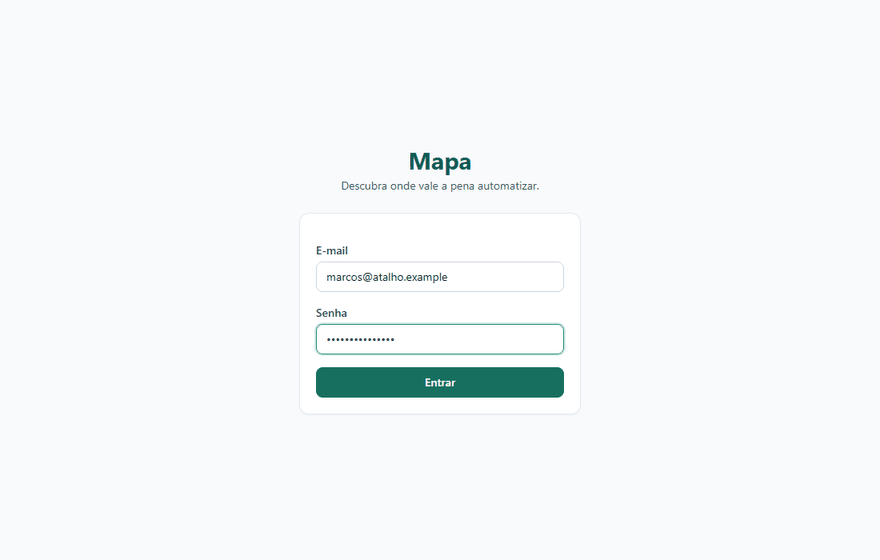
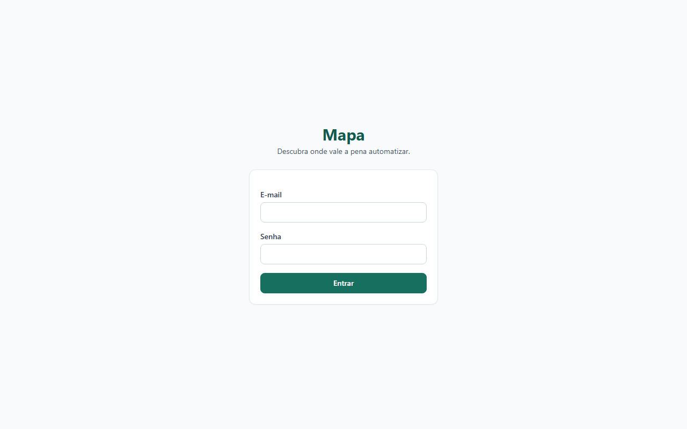
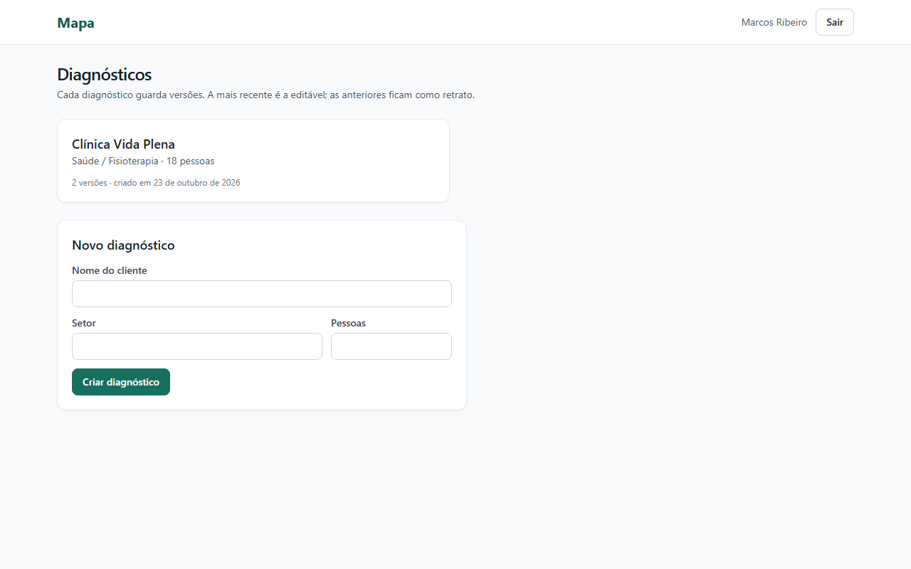
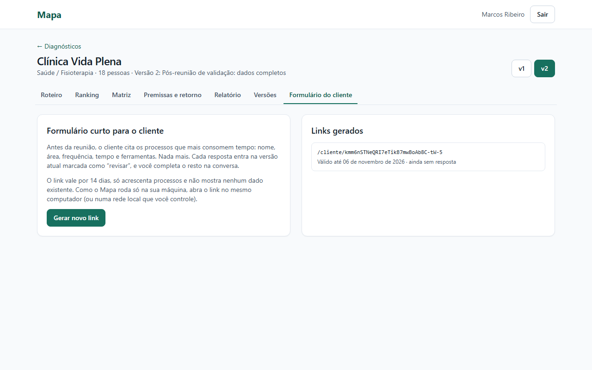

# Galeria de prints

Os 14 prints foram gerados pelo app rodando com o seed da Clínica Vida Plena. A ordem segue o fluxo de uso. Cada legenda tem duas partes: o que se vê · por que importa.

*Sequência de 10 capturas do app rodando (cerca de 22 s): login, abertura do diagnóstico, cadastro de um processo, ranking, matriz, premissas e relatório. Não é uma gravação contínua. O processo "Envio de orçamentos por e-mail" foi cadastrado só para a captura.*

| Tela | Legenda |
|---|---|
|  | **00 · Login.** Cartão com o nome Mapa, campos de e-mail e senha e botão Entrar. · As rotas internas exigem login ([relatório de testes](../05-qualidade/relatorio-de-testes.md)). |
|  | **01 · Lista de diagnósticos.** Um cartão da Clínica Vida Plena (2 versões) e o formulário de novo diagnóstico. · Cada diagnóstico guarda versões; a mais recente é a editável ([ADR-004](../04-arquitetura/adr-004-versoes.md)). |
|  | **02 · Roteiro por área.** Áreas Comercial, Atendimento, Financeiro, Operação e RH, com as três perguntas-chave de Comercial abertas e os processos com horas por mês e completude. · Conduz a conversa de discovery ([perguntas-chave](../01-discovery/perguntas-chave.md)). |
|  | **03 · Cadastro de processo.** Formulário de "Confirmação de consultas por WhatsApp", com escala explicada nos campos de padronização e digitalização. · Campo em branco vira dado faltante ([RN-08](../02-definicao/regras-de-negocio.md)). |
|  | **04 · Ranking.** Os 14 processos por prioridade, com o primeiro aberto: frequência 100, volume 80, repetitividade 75, impacto 53, digitalização 75, facilidade de integração 50 e risco 46. · A explicação vem da conta ([metodologia](../03-metodologia/README.md)). |
|  | **05 · Matriz esforço × retorno.** Quatro quadrantes (Começar já, Planejar, Oportunista, Evitar) com pontos numerados e a lista de processos de cada um. · Pontos numerados porque nomes longos se sobrepõem ([reunião de validação](../04-arquitetura/reuniao-validacao.md)). |
|  | **06 · Premissas e faixa de retorno.** Economia de R$ 3.311 a R$ 6.622, investimento de R$ 64.490 a R$ 106.218 e payback realista de 15,3 meses (de 9,7 a 32,1), com o formulário de premissas abaixo. · O retorno aparece como faixa e declara que é estimativa ([metodologia](../03-metodologia/README.md)). |
|  | **07 · Relatório web.** Oito seções, do resumo executivo a "O que este relatório não sabe", com botão Baixar PDF. · O PDF usa exatamente esta página ([ADR-003](../04-arquitetura/adr-003-geracao-de-pdf.md)). |
|  | **09 · Comparação de versões.** Histórico de duas versões e a comparação v1 → v2 (+21,1 h/mês, +R$ 280 de economia realista, 2 processos novos). · Cada versão é um retrato completo ([ADR-004](../04-arquitetura/adr-004-versoes.md)). |
|  | **11 · Link do cliente (visão do consultor).** Explicação do formulário curto e um link gerado, válido por 14 dias, ainda sem resposta. · O link só acrescenta processos e não mostra dado existente ([ADR-005](../04-arquitetura/adr-005-link-do-cliente.md)). |
|  | **08 · Formulário do cliente.** Seis perguntas (tarefa, área, frequência, minutos, pessoas, ferramentas) e o aviso de não informar dados de pacientes. · É a única tela que o cliente vê ([ADR-005](../04-arquitetura/adr-005-link-do-cliente.md)). |
|  | **12 · Proposta (v1.1).** Escopo de 3 processos, investimento de R$ 23.486 a R$ 38.682, payback de 9,1 meses e a lista "A preencher antes de enviar". · O escopo é o que coube nos 90 dias ([PR da v1.1](../06-pos-lancamento/pr-v1.1-proposta.md)). |
|  | **10 · Mobile, matriz.** Matriz e cartão "Começar já" em largura de 390 px, sem rolagem horizontal na página. · Teste E2E de layout mobile ([relatório de testes](../05-qualidade/relatorio-de-testes.md)). |
|  | **10 · Mobile, roteiro.** A tabela de Comercial aparece cortada a partir da coluna "Hora". · É a limitação conhecida de tabelas no celular ([roadmap](../06-pos-lancamento/roadmap.md)). |

## Telas sem print

- Erro de validação do formulário e senha errada.
- Link do cliente inválido ou expirado.
- Estado vazio (diagnóstico sem processos).
- Página `/imprimir`, a base do PDF.
- Versão antiga em modo somente leitura.

Os arquivos 10-versao-mobile-matriz e 10-versao-mobile-roteiro compartilham o número 10.
